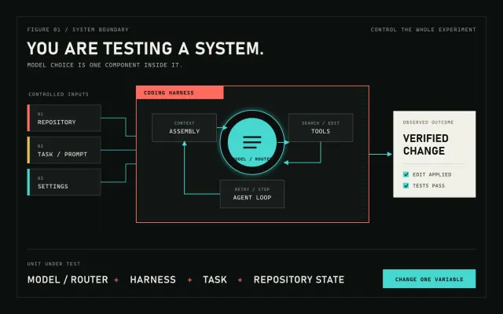
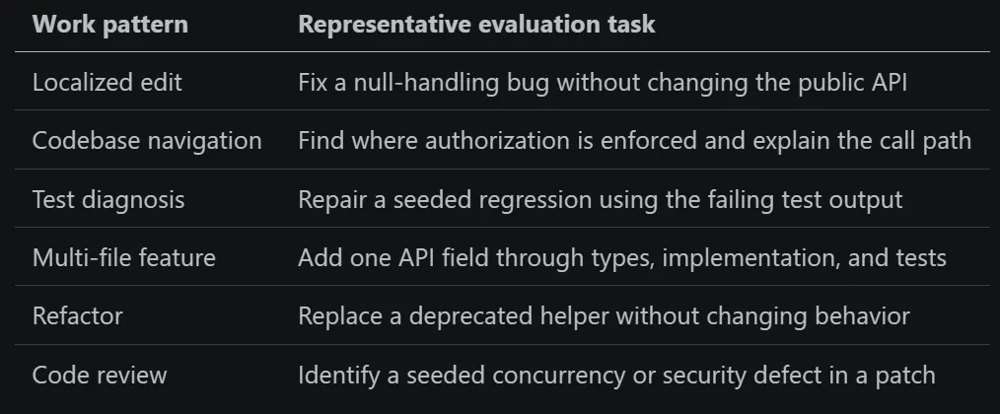
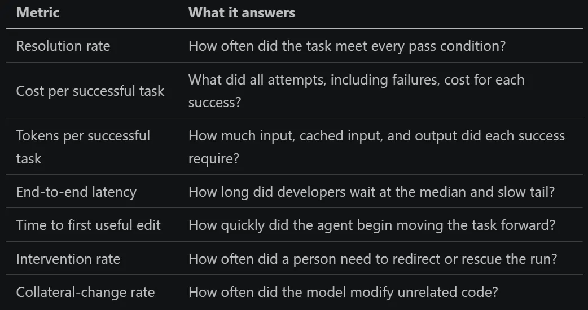
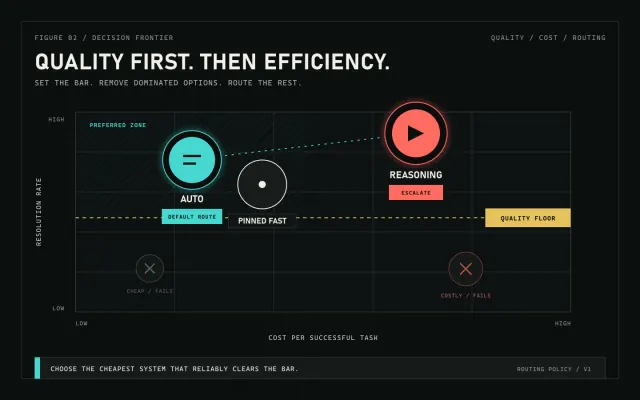
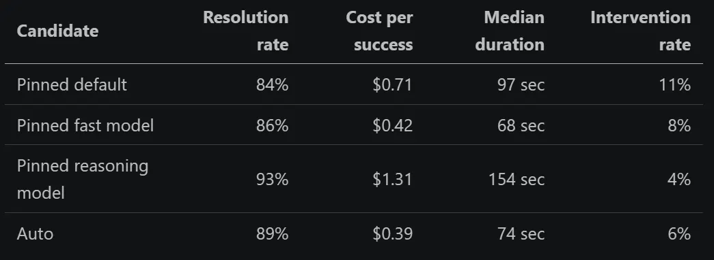
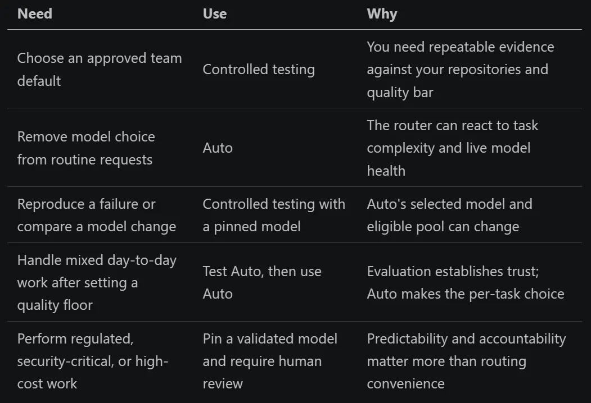

Choosing an AI coding model from a leaderboard is like choosing a route from a screenshot of yesterday's traffic.

The route may have been fastest when it was measured. That does not mean it is fastest from your starting point, with your constraints, under today's conditions.

AI coding models behave the same way. One can solve a contained validation bug quickly, then burn through context on a cross-service migration. Another may feel excessive for the first task but carry contracts, implementation, and tests cleanly through the second. Put either model inside a different coding harness and the result changes again.

This is why two teams can try the same model and reach opposite conclusions:

> This model is wasteful and unreliable.

> This is the first model that can handle our real codebase.

Neither team is necessarily wrong. They measured different journeys.

Leaderboards are still useful, much like an overview map. They reveal the available routes and obvious dead ends. But they cannot account for your repository, harness, task mix, quality bar, or cost constraints.

The useful question is therefore not, "Which model is best?"

> Which model or routing mode, in our coding harness, completes this class of work at the quality, speed, and cost we can accept?

That question turns model selection from a popularity contest into an engineering process.

---

### You Are Testing a System, Not a Model

Inside a tool such as GitHub Copilot, a model does not work alone. It sits inside a coding harness that:

- selects files and conversation history for context;
- supplies system instructions and repository guidance;
- exposes search, edit, terminal, and test tools;
- decides when the agent should continue, retry, or stop;
- translates tool calls into actual changes in the workspace.

Change the model while holding the harness steady and behavior changes. Improve context selection or tool handling while keeping the model steady and behavior changes again. A model that feels disappointing at launch can feel materially better after the surrounding harness is tuned, even if its public name never changes.

So record the real unit under test:

model or routing mode + version/date + harness version + settings + task + repository state

*Evaluate the complete coding system: controlled inputs, model, harness, tools, agent loop, and verified outcome.*

This is also why provider benchmarks do not transfer cleanly into your editor. A model tested in its maker's environment is not the same system your developers use. Public coding benchmarks are still useful as smoke alarms: they can eliminate a candidate that has fallen far behind. But they are weak steering wheels for a team because benchmark tasks may have leaked into training data and many suites overrepresent Python. If your daily work is TypeScript, C#, Go, SQL, and a large monorepo, a Python-heavy leaderboard is measuring only a narrow slice of your job.

Use public results to make a shortlist. Use your work to make the decision.

---

### Build the First Evaluation Set from Last Week's Work

Do not begin by inventing clever puzzles. Open your issue tracker, pull requests, and agent history, then collect 15 to 25 tasks that developers actually attempted recently.

Choose a mix that represents the work you expect the agent to do:

*Choose a mix that represents the work you expect the agent to do*

For every task, freeze five things:

1. Starting state: a commit, fixture, or clean workspace image.
2. Prompt: the exact request given to the agent.
3. Allowed environment: tools, network access, time limit, and token budget.
4. Pass conditions: tests, build checks, and behavioral assertions.
5. Guardrails: files or APIs that must not change.

A task definition can be a short record in a test file, script, or evaluation platform. For example: start from a fixed commit of the checkout service; ask the agent to repair the order regression; allow ten minutes and the normal repository tools; pass only if the targeted test and type check succeed; reject the run if the public API changes. The format does not matter. Reproducing the same starting conditions and grading the same observable outcome does.

Use your preferred product for each discipline you actually need:

- CI orchestration to reset the workspace, invoke the agent, run checks, and collect artifacts;
- sandboxed execution to isolate untrusted code and reproduce the same environment for every run;
- agent evaluation to define task sets, limits, scorers, retries, and model comparisons;
- experiment tracking to compare runs over time and retain prompts, outputs, traces, cost, and latency;
- production observability to turn real failures and interventions into the next evaluation cases.

Start with repository scripts and CI, then add specialized products only when repetition, isolation, analysis, or governance becomes painful. No tool automatically knows what success means in your repository. You still have to provide the starting state, task, constraints, and executable pass conditions.

The grader matters more than an elaborate prompt. Prefer executable outcomes over subjective impressions: the targeted test passes, the full suite stays green, the expected file exists, the API remains compatible, and the diff stays within scope. For tasks such as code review or explanation, use a short rubric with named facts that must be found, then have a human audit a sample of the grades.

Avoid selecting only clean, successful examples. Include underspecified requests, awkward legacy code, and tasks on which the current model failed. That is where candidates separate themselves.

---

### Keep One Evaluation Almost Absurdly Small

Add a task that opens an empty workspace and asks the agent to create a file containing hello world. Grade only two facts: the file exists and its contents are correct.

This task will not tell you whether a model can migrate a service. It tells you whether the basic system still works. Because the task is controlled, a failure can expose regressions in tool calling, file editing, path handling, permissions, or the agent loop. Run it across every supported model and every nightly harness build, and it becomes a cheap canary.

The lesson is broader: a useful evaluation does not have to be intellectually impressive. It has to isolate a behavior and grade it reliably.

---

### Run the Experiment So the Result Means Something

Start by running the suite against your current default. That baseline tells you whether a candidate is actually better or merely new.

Then follow a few strict rules:

- Change one variable at a time. If the model and harness both change, treat the combination as a new system rather than attributing the result to either part.
- Reset to the same repository state before every run.
- Keep prompts, tool access, budgets, and cache policy consistent.
- Record the exact model identifier or alias, run date, harness version, and settings.
- Count abandoned and failed attempts. Their latency and tokens still cost money.
- Repeat every task because LLM output is non-deterministic.

Five trials per task is a useful, inexpensive screen, not a statistically strong conclusion. Increase the run count when candidates are close, variance is high, or the task is important. A single impressive run is a demo. A distribution of runs is evidence.

When a provider updates a model behind an existing alias, the date in your results becomes part of the version. Without it, a rerun next month may look like a contradiction when the underlying system has simply changed.

---

### Measure the Cost of a Successful Outcome

"The patch looked smart" is not a metric. Start with these:

*"The patch looked smart" is not a metric. Start with these*

Calculate cost per success using the cost of all trials divided by the number of successful trials. Otherwise, a model that fails expensively can look artificially efficient because its failed runs disappear from the denominator.

Do not immediately compress everything into one grand score. First set a quality floor for each task class. Among the candidates that clear it, optimize for cost, latency, or developer attention. Plotting resolution rate against cost per successful task is often enough: the interesting candidates sit toward the high-quality, low-cost corner. Models that are both more expensive and less successful are easy to remove.

*Set a quality floor first. Then compare Auto with pinned models on quality, cost, and developer attention.*

An initial scorecard might look like this, using illustrative numbers:

*An initial scorecard might look like this, using illustrative numbers*

There is no universal winner in that table. Auto is an attractive default where it clears the quality bar and removes a decision from routine work. A pinned fast model can still be preferable when reproducibility matters, while the reasoning model earns its higher cost when failure is expensive or the task requires sustained work across many files. Aggregate results can hide those distinctions, so break the same scorecard down by task class before setting policy.

---

### Choose the Operating Path: Test or Auto

There are now two practical responses to the moving-model problem. They solve different decisions.

The testing path asks: what should our team trust? Run controlled evaluations when you need evidence that a model or routing system clears your quality bar. This is the right path for production defaults, regulated or security-sensitive work, fixed budgets, reproducible comparisons, and tasks where a specific model's behavior must be understood. Testing is slower to establish, but it produces an auditable policy: which systems are approved, for which task classes, with what limits and escalation rules.

The Auto path asks: what should handle this request right now? In [GitHub Copilot Auto](https://docs.github.com/en/copilot/concepts/models/auto-model-selection), task-optimized routing combines two signals: real-time model health and availability, and an assessment of the task's complexity. GitHub says that assessment considers factors such as reasoning depth, code-generation complexity, bug-diagnosis difficulty, and tool-orchestration needs. Straightforward work can go to a faster, less expensive model; harder work can go to a stronger reasoning model. Routing happens at natural cache boundaries because switching models arbitrarily in the middle of a session can add cache cost without enough quality benefit.

Auto is a good default for everyday development when the exact model matters less than getting a capable, available response with low friction. It can reduce rate limiting, latency, and the cost of routinely sending simple tasks to heavyweight models. On paid Copilot plans, Auto currently applies a 10% discount to the AI-credit cost of the model it selects. You remain in control: Copilot shows which model produced a response, and you can switch from Auto to a specific model.

Auto still operates inside boundaries. Its candidate pool depends on your Copilot plan, product surface, administrator policies, and restrictions such as data residency or FedRAMP requirements; the pool changes as models are added and retired. Individual subscribers may also need to decide whether evaluation models are allowed. As of July 2026, task-optimized Auto is generally available in Copilot Chat on [GitHub.com](http://GitHub.com) and VS Code, Copilot CLI, the Copilot cloud agent, and the GitHub Copilot app. In JetBrains IDEs, Eclipse, and Xcode, Auto optimizes for reliability and availability rather than task complexity; Visual Studio support for that mode is in public preview. Check the documentation for your client instead of assuming every Auto label uses the same router.

The two paths work best together:

*The two paths work best together*

Treat Auto as another system to evaluate, not as a substitute for evaluation. Run your representative suite with Auto selected, record the model used for each response, and compare the aggregate outcome with pinned candidates. If Auto clears the quality and cost thresholds for a task class, make it the default there. If it does not, pin the validated model and keep the escalation rule explicit. Enterprise administrators can now make Auto the default for new conversations while still allowing users to switch models per conversation.

---

### Re-Test, Because Launch Day Is Not the Final Product

Model selection expires. The model may receive a quiet checkpoint. The harness may improve context packing, tool selection, retries, or caching. Your repository and task mix will change too.

A lightweight cadence keeps the decision current:

- Nightly: run the tiny canary tasks against pinned models, Auto, and supported harness combinations.
- Weekly: run a small, representative smoke suite and alert on material regressions.
- On every model, Auto routing, or harness change: run the full task portfolio before changing defaults.
- One or two weeks after a new model launches: re-test candidates you initially rejected.
- Quarterly: replace stale tasks and add examples from recent failures.

Keep some new tasks out of the tuning loop until the final comparison. Otherwise, you can overfit the harness and prompts to your evaluation set while real-world performance stands still.

---

### Make the Next Choice Observable

You do not need a week-long rollout or a dedicated evaluation platform. Start with three tasks your team completed recently:

- one routine, well-scoped fix;
- one ambiguous or multi-file change;
- one task your current setup handled badly.

Run each task from the same starting state with your current pinned model and with Auto. Repeat the runs, grade the same pass conditions, and record total cost, latency, and human intervention. For Auto runs, also record which model handled each response.

Then write one small operating rule. It might be:

- use Auto for routine work where it clears the quality bar;
- pin the validated reasoning model for high-risk or difficult changes;
- require human review for security-sensitive work;
- re-run the comparison when the model pool, router, or harness changes.

Think of the resulting system as navigation. Your evaluation set is the surveyed map. Auto is the live traffic layer. A pinned model is the known route you preserve when predictability matters more than adapting in real time.

None of those tools decides the destination. Your team still defines what success means, which constraints cannot be violated, and when the cost of being wrong requires a human decision.

The frontier will keep moving. Models will improve, retire, and change behavior. Auto will gain new candidates and routing logic. The durable advantage is not memorizing today's fastest route.

It is knowing when to trust live routing, when to pin a proven path, and when the evidence says your map is out of date.
