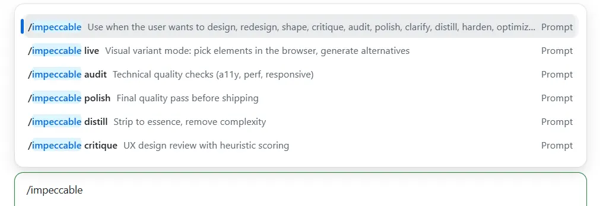
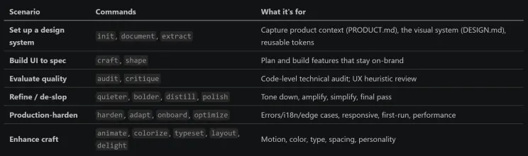
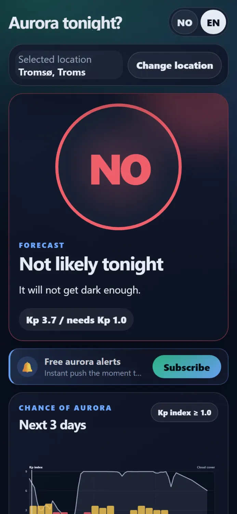
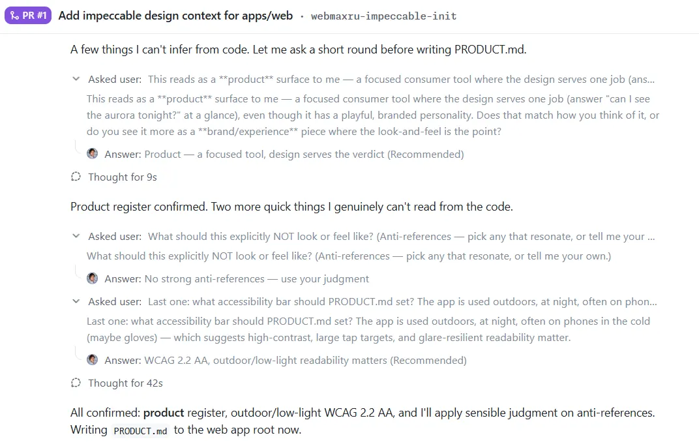
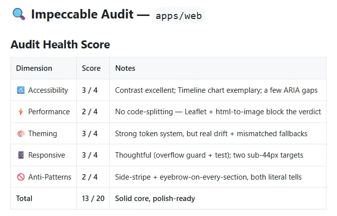
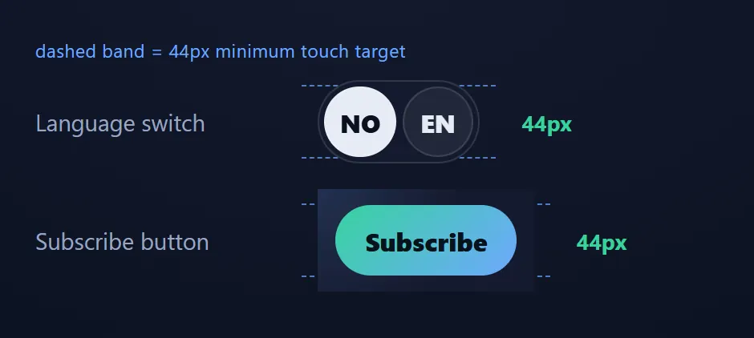
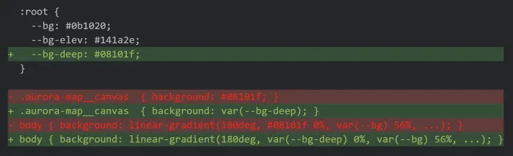
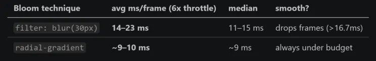
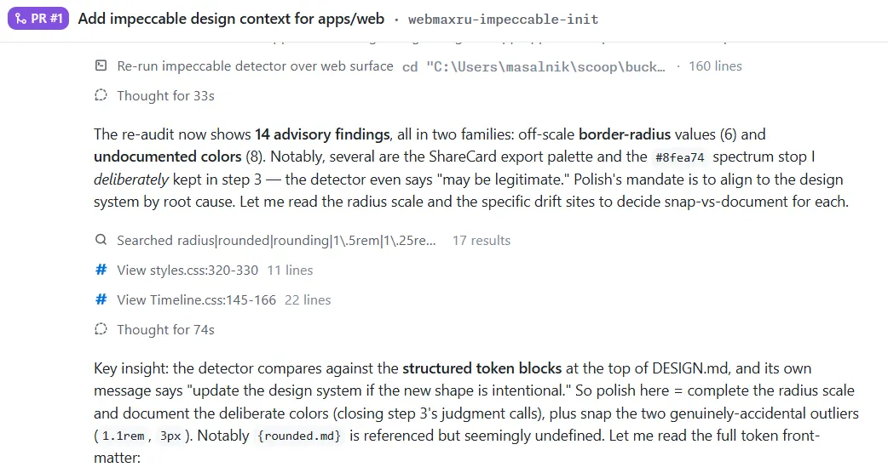
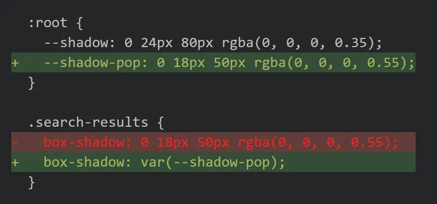

Impeccable — now built into the GitHub Copilot app — treats design quality the way we treat code quality. This is what that looked like on a real app that was already shipping.

We have version control, code review, linters, profilers, and prioritized backlogs for our code. For the design of the things we build, most of us have "looks good to me." This is the story of what happened when I closed that gap — by pointing a skill at my aurora app that brings an engineering discipline to UX.

Two things up front, so you read this with the right expectations.

One: Impeccable is now built into the [GitHub Copilot app](https://github.com/github/app). It's a frontend design skill by [Paul Bakaus](https://www.linkedin.com/in/paulbakaus), bundled in under Apache-2.0, that you invoke right inside a Copilot session — no separate tool, no context switch.


*Impeccable in GitHub Copilot app*

Two: this is not a dramatic before-and-after. My app already worked and already looked fine. There's no ugly-duckling screenshot here, no rescue arc. This is a story about perfecting something that was already good — which is, precisely, what the word impeccable means. If you came for a jaw-dropping makeover, this isn't it. If you've ever wished "good design" were as checkable as "passing tests," read on.

What that looked like in practice: an honest, scored audit, then a prioritized fix list I worked one command at a time — each a small, measured, on-brand improvement, not a rewrite.

### What is the GitHub Copilot app?

GitHub Copilot spans many surfaces — your editor, [github.com](http://github.com), the terminal, the coding agent on pull requests. The GitHub Copilot app is its desktop surface for agentic, task-based work: you describe what you want in plain language, and it works directly in your repository — on real files, running real commands. A few features define this surface:

- Isolated sessions per task. Each task runs in its own Git worktree on its own branch, so experiments never trample your main checkout. This whole audit happened on a throwaway webmaxru-impeccable-init branch.
- Autopilot. It can run autonomously — reading files, running commands, capturing screenshots, opening PRs — and report back when it's done or stuck.
- Parallel, coordinated sessions. You can fan work out across several sessions at once and let them hand off to each other, instead of waiting on a single long thread.
- Skills. This is the important one for our story. A skill is a reusable expert playbook the agent can load on demand. Skills bring domain knowledge, scripts, and a strict workflow the agent didn't have on its own. Impeccable is one such skill. So is the storytelling skill that shaped this very post.

### What is Impeccable?

[𝗜𝗺𝗽𝗲𝗰𝗰𝗮𝗯𝗹𝗲](https://impeccable.style/) is a frontend design skill by 𝗣𝗮𝘂𝗹 𝗕𝗮𝗸𝗮𝘂𝘀, bundled into the Copilot app under Apache-2.0. Its one-line pitch is the opposite of what you expect from an AI design tool:

```
𝘔𝘢𝘵𝘤𝘩𝘪𝘯𝘨 𝘺𝘰𝘶𝘳 𝘴𝘺𝘴𝘵𝘦𝘮. 𝘕𝘰𝘵 𝘪𝘯𝘷𝘦𝘯𝘵𝘪𝘯𝘨 𝘰𝘯𝘦.
```

That sentence is the whole philosophy. Most AI design help drags you toward the same global average — the cream-and-navy, glassy-card, gradient-text "𝗔𝗜 𝘀𝗹𝗼𝗽" look. Impeccable does the reverse: it pins down 𝘺𝘰𝘶𝘳 product's voice and palette first, writes them down as a committed design system, and then measures everything against 𝘵𝘩𝘢𝘵. It even ships a literal "𝗔𝗜 𝘀𝗹𝗼𝗽 𝘁𝗲𝘀𝘁": if someone could look at your interface and say "AI made that" without a doubt, it failed.

It's not one command — it's a whole vocabulary of them, grouped by intent:


*Impeccable commands*

The key scenarios, in plain terms: 𝗯𝗼𝗼𝘁𝘀𝘁𝗿𝗮𝗽 𝗮 𝗱𝗲𝘀𝗶𝗴𝗻 𝘀𝘆𝘀𝘁𝗲𝗺 𝗳𝗿𝗼𝗺 𝗮𝗻 𝗲𝘅𝗶𝘀𝘁𝗶𝗻𝗴 𝗰𝗼𝗱𝗲𝗯𝗮𝘀𝗲, 𝗯𝘂𝗶𝗹𝗱 𝗻𝗲𝘄 𝗨𝗜 𝘁𝗵𝗮𝘁 𝗱𝗼𝗲𝘀𝗻'𝘁 𝗱𝗿𝗶𝗳𝘁 𝗳𝗿𝗼𝗺 𝗶𝘁, 𝗴𝗲𝘁 𝗮𝗻 𝗵𝗼𝗻𝗲𝘀𝘁 𝗮𝘂𝗱𝗶𝘁 𝗼𝗳 𝘄𝗵𝗮𝘁'𝘀 𝗮𝗰𝘁𝘂𝗮𝗹𝗹𝘆 𝘄𝗿𝗼𝗻𝗴, and 𝗳𝗶𝘅 𝗶𝘀𝘀𝘂𝗲𝘀 𝗼𝗻𝗲 𝘁𝗮𝗿𝗴𝗲𝘁𝗲𝗱 𝗰𝗼𝗺𝗺𝗮𝗻𝗱 𝗮𝘁 𝗮 𝘁𝗶𝗺𝗲 instead of one vague "make it prettier."

### The demo app: Nordlys i natt?


*Northern lights tonight?*

[𝗡𝗼𝗿𝗱𝗹𝘆𝘀 𝗶 𝗻𝗮𝘁𝘁?](https://nordlys.isainative.dev/) ("Northern lights tonight?") is a go/no-go decision tool. It fuses three open data sources — aurora strength (NOAA SWPC Kp + the OVATION oval), cloud cover (MET Norway), and darkness (computed sun elevation) — into a single verdict: 𝗚𝗢 / 𝗠𝗔𝗬𝗕𝗘 / 𝗡𝗢 (in Norwegian, 𝗝𝗔 / 𝗞𝗔𝗡𝗦𝗞𝗝𝗘 / 𝗡𝗘𝗜).

The audience matters, because it shaped every design decision: someone standing 𝗼𝘂𝘁𝗱𝗼𝗼𝗿𝘀, 𝗶𝗻 𝘁𝗵𝗲 𝗔𝗿𝗰𝘁𝗶𝗰 𝗰𝗼𝗹𝗱, 𝗮𝘁 𝗻𝗶𝗴𝗵𝘁, 𝗼𝗻 𝗮 𝗱𝗶𝗺 𝗽𝗵𝗼𝗻𝗲, 𝗺𝗮𝘆𝗯𝗲 𝘄𝗶𝘁𝗵 𝗴𝗹𝗼𝘃𝗲𝘀 𝗼𝗻, 𝗼𝗻 𝗽𝗮𝘁𝗰𝗵𝘆 𝗺𝗼𝗯𝗶𝗹𝗲 𝗱𝗮𝘁𝗮. They don't want a dashboard. They want one glance and a trustworthy answer.

Look at what the app actually told me when I checked Tromsø: 𝗡𝗢 — "𝗜𝘁 𝘄𝗶𝗹𝗹 𝗻𝗼𝘁 𝗴𝗲𝘁 𝗱𝗮𝗿𝗸 𝗲𝗻𝗼𝘂𝗴𝗵." Here's the lovely part: the Kp index is 𝟯.𝟳, which is genuinely decent aurora activity. A lazier app would've flashed green on that number alone. But it's late June above the Arctic Circle — the midnight sun means it never gets properly dark — so the honest answer is 𝘯𝘰, 𝘯𝘰𝘵 𝘵𝘰𝘯𝘪𝘨𝘩𝘵, regardless of how active the sun is. The verdict engine refuses to give you false hope. That honesty 𝗶𝘀 the product.

The design system the app commits to has a name — "𝗧𝗵𝗲 𝗡𝗶𝗴𝗵𝘁-𝗦𝗸𝘆 𝗢𝗿𝗮𝗰𝗹𝗲" — and a few hard rules:

- 𝗧𝗵𝗲 𝘃𝗲𝗿𝗱𝗶𝗰𝘁 𝗶𝘀 𝘁𝗵𝗲 𝗯𝗿𝗶𝗴𝗵𝘁𝗲𝘀𝘁, 𝗹𝗮𝗿𝗴𝗲𝘀𝘁 𝘁𝗵𝗶𝗻𝗴 𝗼𝗻 𝘀𝗰𝗿𝗲𝗲𝗻. Answer first, evidence second.
- 𝗖𝗼𝗹𝗼𝗿 𝗺𝗲𝗮𝗻𝘀 𝘀𝘁𝗮𝘁𝗲. Green/amber/coral are 𝘰𝘯𝘭𝘺 𝘦𝘷𝘦𝘳 go/maybe/no, always paired with the word (so it survives color-blindness and outdoor glare).
- 𝗢𝗻𝗲 𝘀𝘆𝘀𝘁𝗲𝗺 𝗳𝗼𝗻𝘁, no web-font download — the verdict has to paint instantly on a cold phone.
- 𝗚𝗹𝗮𝘀𝘀𝘆 𝘀𝗹𝗮𝗯𝘀 𝗳𝗹𝗼𝗮𝘁𝗶𝗻𝗴 𝗼𝗻 𝗮 𝗱𝗲𝗲𝗽 𝗻𝗮𝘃𝘆 𝗻𝗶𝗴𝗵𝘁, with exactly one glowing element: the gauge.

On mobile, the doctrine is even clearer — the verdict fills the screen, and everything else falls in line beneath it:


*On mobile, the doctrine is even clearer*

### My use case: from "looks fine" to "prove it"

I didn't ask Impeccable to redesign anything. I asked it two questions, in two steps.

𝗦𝘁𝗲𝗽 𝟭 — 𝚒𝚖𝚙𝚎𝚌𝚌𝚊𝚋𝚕𝚎 𝚒𝚗𝚒𝚝: 𝘄𝗿𝗶𝘁𝗲 𝗱𝗼𝘄𝗻 𝘄𝗵𝗮𝘁 "𝗴𝗼𝗼𝗱" 𝗺𝗲𝗮𝗻𝘀


*Quick "interview"*

A skill can't audit a design against a standard that doesn't exist yet. So 𝚒𝚗𝚒𝚝 ran a short interview — 𝘐𝘴 𝘥𝘦𝘴𝘪𝘨𝘯 𝘵𝘩𝘦 𝘱𝘳𝘰𝘥𝘶𝘤𝘵, 𝘰𝘳 𝘥𝘰𝘦𝘴 𝘥𝘦𝘴𝘪𝘨𝘯 𝘴𝘦𝘳𝘷𝘦 𝘵𝘩𝘦 𝘱𝘳𝘰𝘥𝘶𝘤𝘵? 𝘞𝘩𝘢𝘵'𝘴 𝘵𝘩𝘦 𝘢𝘤𝘤𝘦𝘴𝘴𝘪𝘣𝘪𝘭𝘪𝘵𝘺 𝘣𝘢𝘳? 𝘞𝘩𝘢𝘵'𝘴 𝘵𝘩𝘦 𝘤𝘳𝘦𝘢𝘵𝘪𝘷𝘦 𝘯𝘰𝘳𝘵𝘩 𝘴𝘵𝘢𝘳? — and from my answers plus a read of the existing code, it generated two committed files:

- 𝚊𝚙𝚙𝚜/𝚠𝚎𝚋/𝙿𝚁𝙾𝙳𝚄𝙲𝚃.𝚖𝚍 — the strategic context: who uses this, the brand voice (𝘤𝘭𝘦𝘢𝘳, 𝘩𝘰𝘯𝘦𝘴𝘵, 𝘯𝘰𝘳𝘵𝘩𝘦𝘳𝘯), the anti-references (no cluttered weather dashboards, no AI-slop decoration), and a hard accessibility bar: 𝗪𝗖𝗔𝗚 𝟮.𝟮 𝗔𝗔, 𝘄𝗲𝗶𝗴𝗵𝘁𝗲𝗱 𝗳𝗼𝗿 𝗼𝘂𝘁𝗱𝗼𝗼𝗿𝘀 𝗮𝘁 𝗻𝗶𝗴𝗵𝘁.
- 𝚊𝚙𝚙𝚜/𝚠𝚎𝚋/𝙳𝙴𝚂𝙸𝙶𝙽.𝚖𝚍 — the visual system: the dark "Night-Sky Oracle" theme, the semantic verdict palette, the system-font typography, the glass-slab elevation rules, plus a machine-readable .𝚒𝚖𝚙𝚎𝚌𝚌𝚊𝚋𝚕𝚎/𝚍𝚎𝚜𝚒𝚐𝚗.𝚓𝚜𝚘𝚗 sidecar.

That's the unlock. The design system is now 𝗰𝗼𝗱𝗲 𝗶𝗻 𝘁𝗵𝗲 𝗿𝗲𝗽𝗼, reviewed in a PR, not a vibe in my head. Everything after this measures against it.

𝗦𝘁𝗲𝗽 𝟮 — 𝚒𝚖𝚙𝚎𝚌𝚌𝚊𝚋𝚕𝚎 𝚊𝚞𝚍𝚒𝚝 𝚊𝚙𝚙𝚜/𝚠𝚎𝚋: 𝗮𝗻 𝗵𝗼𝗻𝗲𝘀𝘁, 𝗰𝗼𝗱𝗲-𝗹𝗲𝘃𝗲𝗹 𝗿𝗲𝗽𝗼𝗿𝘁

The 𝚊𝚞𝚍𝚒𝚝 command is explicitly 𝘯𝘰𝘵 a redesign. Its rule is: 𝗱𝗼𝗰𝘂𝗺𝗲𝗻𝘁 𝗶𝘀𝘀𝘂𝗲𝘀, 𝗱𝗼 𝗻𝗼𝘁 𝗳𝗶𝘅 𝘁𝗵𝗲𝗺. It scans five dimensions, scores each 0–4, and tags every finding P0–P3. Under the hood it runs a static detector over the CSS and components, and — because my accessibility bar is about reading a verdict outdoors — I had it compute the 𝘢𝘤𝘵𝘶𝘢𝘭 WCAG contrast ratios (with real translucency compositing) for every text/background pair.

Here's where it landed:


*Impeccable audit results*

The contrast result was the happy surprise: I'd assumed my muted gray text would be the problem (it's the single most common AI design failure). Verified with real math, it passed comfortably — 𝗮 𝗽𝗼𝘀𝗶𝘁𝗶𝘃𝗲 𝗳𝗶𝗻𝗱𝗶𝗻𝗴, 𝗻𝗼𝘁 𝗮 𝗴𝘂𝗲𝘀𝘀. The audit celebrates what works, which is how you learn to trust the parts that flag red.

And one part flagged red.

### The fix list: 🛠 Recommended Actions, one by one

The most useful thing about an Impeccable audit isn't the score — it's that every finding maps to a 𝘴𝘱𝘦𝘤𝘪𝘧𝘪𝘤 𝘤𝘰𝘮𝘮𝘢𝘯𝘥 you can run next. Here's the priority-ordered list it gave me, and what each command actually does.

𝟭. /𝚒𝚖𝚙𝚎𝚌𝚌𝚊𝚋𝚕𝚎 𝚚𝚞𝚒𝚎𝚝𝚎𝚛 — 𝗿𝗲𝗺𝗼𝘃𝗲 𝗮𝗻 𝗔𝗜-𝘀𝗹𝗼𝗽 𝗯𝗼𝗿𝗱𝗲𝗿 (𝗣𝟮)

The audit's anti-pattern detector flagged a 𝚋𝚘𝚛𝚍𝚎𝚛-𝚕𝚎𝚏𝚝: 𝟹𝚙𝚡 𝚜𝚘𝚕𝚒𝚍 𝚟𝚊𝚛(--𝚊𝚌𝚌𝚎𝚗𝚝) on the "Free aurora alerts" opt-in row (𝙽𝚘𝚝𝚒𝚏𝚢𝙱𝚞𝚝𝚝𝚘𝚗.𝚌𝚜𝚜). A colored side-stripe like this is on Impeccable's list of 𝗮𝗯𝘀𝗼𝗹𝘂𝘁𝗲 𝗯𝗮𝗻𝘀 — its docs call it "𝘵𝘩𝘦 𝘮𝘰𝘴𝘵 𝘳𝘦𝘤𝘰𝘨𝘯𝘪𝘻𝘢𝘣𝘭𝘦 𝘵𝘦𝘭𝘭 𝘰𝘧 𝘈𝘐-𝘨𝘦𝘯𝘦𝘳𝘢𝘵𝘦𝘥 𝘜𝘐𝘴." The detector caught it mechanically, with zero ambiguity, the way a linter catches a banned API call. Look at the 𝗹𝗲𝗳𝘁 𝗲𝗱𝗴𝗲:


*AI-slop border*

𝚚𝚞𝚒𝚎𝚝𝚎𝚛 is the "tone down an attention-seeking element" command. The bans rule says replace a side-stripe with "𝘧𝘶𝘭𝘭 𝘣𝘰𝘳𝘥𝘦𝘳𝘴, 𝘣𝘢𝘤𝘬𝘨𝘳𝘰𝘶𝘯𝘥 𝘵𝘪𝘯𝘵𝘴, 𝘭𝘦𝘢𝘥𝘪𝘯𝘨 𝘯𝘶𝘮𝘣𝘦𝘳𝘴/𝘪𝘤𝘰𝘯𝘴, 𝘰𝘳 𝘯𝘰𝘵𝘩𝘪𝘯𝘨." The CTA already had the good options — a bell icon in an accent chip, a faint accent glow, and an all-around accent border — so the stripe was pure redundant tell. The fix: delete it, and nudge the existing full border from 35% to 45% opacity so the row still reads as a highlight. Same hierarchy, same "important and free" read — minus the AI uniform. The detector that flagged the stripe now scans the file clean. One finding down.

𝟮. /𝚒𝚖𝚙𝚎𝚌𝚌𝚊𝚋𝚕𝚎 𝚊𝚍𝚊𝚙𝚝 — 𝗳𝗶𝘅 𝘁𝗵𝗲 𝘀𝘂𝗯-𝟰𝟰𝗽𝘅 𝘁𝗮𝗽 𝘁𝗮𝗿𝗴𝗲𝘁𝘀 (𝗣𝟮)

Two controls sat below my own 44px minimum: the 𝗹𝗮𝗻𝗴𝘂𝗮𝗴𝗲 𝘀𝘄𝗶𝘁𝗰𝗵 (40px) and that same notify CTA's 𝗦𝘂𝗯𝘀𝗰𝗿𝗶𝗯𝗲 𝗯𝘂𝘁𝘁𝗼𝗻 (𝚖𝚒𝚗-𝚑𝚎𝚒𝚐𝚑𝚝: 𝟸.𝟺𝚛𝚎𝚖 ≈ 38.4px). On most apps that's a nitpick. On 𝘵𝘩𝘪𝘴 app it's a real-world accessibility failure — remember the user is 𝗼𝘂𝘁𝗱𝗼𝗼𝗿𝘀, 𝗰𝗼𝗹𝗱, 𝗴𝗹𝗼𝘃𝗲𝗱, 𝗼𝗻𝗲-𝗵𝗮𝗻𝗱𝗲𝗱. A 38px target you keep missing in the dark is a broken feature.

𝚊𝚍𝚊𝚙𝚝 is the responsive-behavior command, and its touch rule is blunt: 𝟰𝟰𝘅𝟰𝟰𝗽𝘅 𝗺𝗶𝗻𝗶𝗺𝘂𝗺, 𝗻𝗼 𝗲𝘅𝗰𝗲𝗽𝘁𝗶𝗼𝗻𝘀. It found the two outliers and raised each back to the 𝟸.𝟽𝟻𝚛𝚎𝚖 (44px) field standard the rest of the app already meets.

This is the kind of fix you can't eyeball, so I measured it. Here are both controls against a dashed band drawn at exactly 44px — before, then after. The numbers are the live rendered heights, read straight off the DOM:


*Fixed tap targets*

40 and 38.4 become a clean 44/44. Not a restyle — a dimension. The kind of thing that never shows up in a demo and absolutely shows up when you're stabbing at a button with a gloved thumb on a freezing night.

𝟯. /𝚒𝚖𝚙𝚎𝚌𝚌𝚊𝚋𝚕𝚎 𝚎𝚡𝚝𝚛𝚊𝚌𝚝 — 𝘀𝘁𝗼𝗽 𝘁𝗵𝗲 𝘁𝗼𝗸𝗲𝗻 𝗱𝗿𝗶𝗳𝘁 (𝗣𝟮)

The detector flagged 𝘵𝘰𝘬𝘦𝘯 𝘥𝘳𝘪𝘧𝘵: component stylesheets hard-coding hex values and using fallbacks that didn't match the real token. None of these break anything today. But they're how a design system rots — every drift makes the next one look normal.

𝚎𝚡𝚝𝚛𝚊𝚌𝚝 pulls reusable values 𝘶𝘱 into the design system so the documented palette in 𝙳𝙴𝚂𝙸𝙶𝙽.𝚖𝚍 stays the single source of truth. The best catch was almost poetic. 𝙳𝙴𝚂𝙸𝙶𝙽.𝚖𝚍 already documented a colour role called 𝗡𝗶𝗴𝗵𝘁 𝗗𝗲𝗲𝗽 (#08101f) — "the map canvas, input wells, the bottom of the body gradient, the share card's base." Every one of those surfaces was real. But there was 𝗻𝗼 --𝚋𝚐-𝚍𝚎𝚎𝚙 𝘁𝗼𝗸𝗲𝗻. The value lived as a copy-pasted #08101f literal in three different files. The design doc described a token the CSS never actually had. So I created it and pointed the three literals at it:


*Stopping the token drift*

Three more drift fixes rode along: the share card's base was a literal #0b1020 — that's just --𝚋𝚐, so it became 𝚟𝚊𝚛(--𝚋𝚐). The map legend faded its green with a hand-typed 𝚛𝚐𝚋𝚊(𝟻𝟼, 𝟸𝟷𝟷, 𝟷𝟻𝟿, 𝟶.𝟸) (literally --𝚐𝚘 at 20%), now 𝚌𝚘𝚕𝚘𝚛-𝚖𝚒𝚡(𝚒𝚗 𝚜𝚛𝚐𝚋, 𝚟𝚊𝚛(--𝚐𝚘) 𝟸𝟶%, 𝚝𝚛𝚊𝚗𝚜𝚙𝚊𝚛𝚎𝚗𝚝) so it tracks the token. And the privacy panel's 𝚟𝚊𝚛(--𝚏𝚐, #f5f7fb) / 𝚟𝚊𝚛(--𝚖𝚞𝚝𝚎𝚍, #aab4cf) fallbacks were quietly 𝘸𝘳𝘰𝘯𝘨 — the real tokens are #e7ecf5 and #9aa6c0 — so a missing variable would have rendered a different colour than the system says. Fixed to match.

What I 𝗱𝗶𝗱𝗻'𝘁 do is the tell that this is a design skill and not find-and-replace. The map's #8fea74 spectrum highlight and the share card's punchier export palette are genuine one-offs — distinct by intent, used once. 𝚎𝚡𝚝𝚛𝚊𝚌𝚝's own rule is 𝘤𝘰𝘯𝘴𝘰𝘭𝘪𝘥𝘢𝘵𝘦 𝘸𝘩𝘢𝘵'𝘴 𝘵𝘳𝘶𝘭𝘺 𝘴𝘩𝘢𝘳𝘦𝘥, 𝘭𝘦𝘢𝘷𝘦 𝘸𝘩𝘢𝘵 𝘪𝘴𝘯'𝘵, so I left them and said so. Taste, not a sweep.

There's no before/after screenshot here, and that's the whole point: every change is value-for-value identical, so the rendered pixels don't move. The proof is the diff plus a green build on byte-identical output — drift removed, design unchanged.

𝟰. /𝚒𝚖𝚙𝚎𝚌𝚌𝚊𝚋𝚕𝚎 𝚘𝚙𝚝𝚒𝚖𝚒𝚣𝚎 — 𝗽𝗿𝗼𝗳𝗶𝗹𝗲 𝘁𝗵𝗲 𝗴𝗹𝗮𝘀𝘀 (𝗣𝟯)

Every panel uses an 18px 𝚋𝚊𝚌𝚔𝚍𝚛𝚘𝚙-𝚏𝚒𝚕𝚝𝚎𝚛 blur, and the verdict gauge adds a 30px 𝚏𝚒𝚕𝚝𝚎𝚛: 𝚋𝚕𝚞𝚛 bloom behind the JA/KANSKJE/NEI badge. It's gorgeous, and blur is the most expensive thing the GPU does on a cheap phone. This is P3 — nice-to-fix, no 𝘱𝘳𝘰𝘷𝘦𝘯 problem — so the rule is blunt: 𝗺𝗲𝗮𝘀𝘂𝗿𝗲 𝗳𝗶𝗿𝘀𝘁, 𝗰𝗵𝗮𝗻𝗴𝗲 𝗻𝗼𝘁𝗵𝗶𝗻𝗴 𝘆𝗼𝘂 𝗰𝗮𝗻'𝘁 𝘀𝗵𝗼𝘄 𝗶𝘀 𝘀𝗹𝗼𝘄.

So I measured, head-to-head, the blur bloom versus the same glow drawn as a 𝚛𝚊𝚍𝚒𝚊𝚕-𝚐𝚛𝚊𝚍𝚒𝚎𝚗𝚝 (no filter pass). On my unthrottled desktop, both ran at 𝟴.𝟯 𝗺𝘀/𝗳𝗿𝗮𝗺𝗲 — pinned to the 120Hz vsync interval. 𝘕𝘰 𝘥𝘪𝘧𝘧𝘦𝘳𝘦𝘯𝘤𝘦 𝘢𝘵 𝘢𝘭𝘭. That's the trap: a fast desktop has so much GPU headroom that it hides the cost completely, and you'd "prove" there's no problem. So I throttled the CPU 6x to emulate a cold mid-range Android — the device this app actually ships to — and ran it several times:


*Measuring rendering speed*

Roughly a 𝘁𝗵𝗶𝗿𝗱 𝗹𝗲𝘀𝘀 𝗳𝗿𝗮𝗺𝗲 𝘁𝗶𝗺𝗲, repeatable, for a glow you can't tell apart. And the fix wrote itself: the gauge 𝘣𝘢𝘥𝘨𝘦 two rules below already makes its glow with a free 𝚛𝚊𝚍𝚒𝚊𝚕-𝚐𝚛𝚊𝚍𝚒𝚎𝚗𝚝 — the bloom was the lone outlier paying for a 30px blur to do a job the design system already does for nothing. So I matched the existing pattern and dropped the filter.

Same glow — blurred disc on the left, gradient on the right:


*Optimized glow*

What I 𝗱𝗶𝗱𝗻'𝘁 touch is the point. The panels' 𝚋𝚊𝚌𝚔𝚍𝚛𝚘𝚙-𝚏𝚒𝚕𝚝𝚎𝚛: 𝚋𝚕𝚞𝚛(𝟷𝟾𝚙𝚡) is the 𝘳𝘦𝘢𝘭 glass — it samples whatever's actually behind it, and no gradient can fake that. It's static (composited once, not re-blurred every frame) and it wasn't the hotspot. 𝚘𝚙𝚝𝚒𝚖𝚒𝚣𝚎's whole doctrine is 𝘧𝘪𝘹 𝘵𝘩𝘦 𝘢𝘤𝘵𝘶𝘢𝘭 𝘣𝘰𝘵𝘵𝘭𝘦𝘯𝘦𝘤𝘬, 𝘭𝘦𝘢𝘷𝘦 𝘵𝘩𝘦 𝘳𝘦𝘴𝘵 — so the glass stays exactly as designed. The honest result of this step is one removed filter pass and a measurement that told me where 𝗻𝗼𝘁 to spend effort.

𝟱. /𝚒𝚖𝚙𝚎𝚌𝚌𝚊𝚋𝚕𝚎 𝚙𝚘𝚕𝚒𝚜𝚑 — 𝘁𝗵𝗲 𝗳𝗶𝗻𝗮𝗹 𝗽𝗮𝘀𝘀

The last-mile sweep across the whole surface once the targeted commands have landed. 𝚙𝚘𝚕𝚒𝚜𝚑 runs the bundled detector over the markup and styles and reports everything that drifts from the design system. On my surface it returned 𝟭𝟰 𝗮𝗱𝘃𝗶𝘀𝗼𝗿𝗶𝗲𝘀: six border-radius values that weren't on the documented scale, and eight colors that weren't in 𝙳𝙴𝚂𝙸𝙶𝙽.𝚖𝚍.


*Polishing*

Here's where 𝚙𝚘𝚕𝚒𝚜𝚑 quietly taught me its most important rule, the one printed right in its own reference: 𝗮 𝗰𝗹𝗲𝗮𝗻 𝗿𝗲𝘀𝘂𝗹𝘁 𝗶𝘀 𝗻𝗲𝘃𝗲𝗿 𝗽𝗿𝗼𝗼𝗳 𝘁𝗵𝗲 𝗱𝗲𝘀𝗶𝗴𝗻 𝗶𝘀 𝘀𝘁𝗿𝗼𝗻𝗴, 𝘀𝗼 𝗱𝗿𝗶𝘃𝗶𝗻𝗴 𝘁𝗵𝗲 𝗰𝗼𝘂𝗻𝘁 𝘁𝗼 𝘇𝗲𝗿𝗼 𝗶𝘀 𝗻𝗼𝘁 𝘁𝗵𝗲 𝗴𝗼𝗮𝗹. The goal is to 𝘮𝘢𝘬𝘦 𝘢 𝘥𝘦𝘤𝘪𝘴𝘪𝘰𝘯 𝘢𝘣𝘰𝘶𝘵 𝘦𝘷𝘦𝘳𝘺 𝘧𝘪𝘯𝘥𝘪𝘯𝘨 — and there are only two honest decisions: it's accidental drift, so snap it to the system; or it's genuine intent, so name it 𝘪𝘯 the system. Silencing a finding is neither.

So I went down the 14 one at a time and sorted each into snap-or-document:

- 𝗦𝗻𝗮𝗽 𝘁𝗵𝗲 𝗮𝗰𝗰𝗶𝗱𝗲𝗻𝘁𝘀. A search dropdown at 𝟷.𝟷𝚛𝚎𝚖, the map canvas at 𝟷.𝟸𝟻𝚛𝚎𝚖, a timeline legend band at 𝟹𝚙𝚡, a ShareCard tile at 𝟸𝟸𝚙𝚡 — radii that were 𝘢𝘭𝘮𝘰𝘴𝘵 on-scale, the kind of 1-and-2-pixel slop that creeps in when you eyeball a value at 1 a.m. Each snapped to its nearest documented step (𝟷𝚛𝚎𝚖, 𝟸𝚙𝚡, 𝟷.𝟻𝚛𝚎𝚖). Invisible individually; collectively they're the difference between a system and a pile of close-enoughs.
- 𝗖𝗼𝗺𝗽𝗹𝗲𝘁𝗲 𝘁𝗵𝗲 𝘀𝗰𝗮𝗹𝗲 𝘀𝗼 𝘁𝗵𝗲 𝗹𝗲𝗴𝗶𝘁 𝘃𝗮𝗹𝘂𝗲𝘀 𝗵𝗮𝘃𝗲 𝗮 𝗵𝗼𝗺𝗲. Some radii were 𝘥𝘦𝘭𝘪𝘣𝘦𝘳𝘢𝘵𝘦𝘭𝘺 tiny (a 2px chip) or large (the 32px export card) — fine choices the scale simply didn't name yet. Rather than distort them to fit, I extended the scale: added 𝚡𝚜: 𝟸𝚙𝚡 and 𝚡𝚕: 𝟸𝚛𝚎𝚖 to 𝙳𝙴𝚂𝙸𝙶𝙽.𝚖𝚍. Now the small and large radii are on the scale instead of off it.
- 𝗗𝗼𝗰𝘂𝗺𝗲𝗻𝘁 𝘁𝗵𝗲 𝗴𝗲𝗻𝘂𝗶𝗻𝗲 𝗶𝗻𝘁𝗲𝗻𝘁. The eight "undocumented" colors weren't sloppiness — they were the ShareCard's deliberately brighter export palette (it renders a 𝘥𝘰𝘸𝘯𝘭𝘰𝘢𝘥𝘢𝘣𝘭𝘦 𝘗𝘕𝘎, tuned to pop in a social feed, not on the live dark UI) plus a one-off aurora-green map stop. That's real intent, so I gave it real names in 𝙳𝙴𝚂𝙸𝙶𝙽.𝚖𝚍: 𝚜𝚑𝚊𝚛𝚎-𝚒𝚗𝚔, 𝚜𝚑𝚊𝚛𝚎-𝚖𝚞𝚝𝚎𝚍, the two 𝚜𝚑𝚊𝚛𝚎-𝚐𝚕𝚘𝚠-\* rgba glows, and 𝚊𝚞𝚛𝚘𝚛𝚊-𝚜𝚙𝚎𝚌𝚝𝚛𝚞𝚖. And the single magic shadow left inline — 𝟶 𝟷𝟾𝚙𝚡 𝟻𝟶𝚙𝚡 𝚛𝚐𝚋𝚊(𝟶,𝟶,𝟶,𝟶.𝟻𝟻) on that dropdown — became a --𝚜𝚑𝚊𝚍𝚘𝚠-𝚙𝚘𝚙 elevation token, pairing the existing --𝚜𝚑𝚊𝚍𝚘𝚠 for panels into a real two-level elevation system:


*A new elevation system*

Re-run the detector: 𝟭𝟰 → 𝟬. But the zero isn't the trophy — 𝘵𝘩𝘦 𝘥𝘦𝘤𝘪𝘴𝘪𝘰𝘯𝘴 𝘢𝘳𝘦. Not one finding was hushed; each was either snapped to the system or written into it. As with 𝚎𝚡𝚝𝚛𝚊𝚌𝚝, there's no before/after screenshot because nothing moved on screen by more than a pixel — a 32px card and a 𝟸𝚛𝚎𝚖 card are the same card. What changed is that 𝙳𝙴𝚂𝙸𝙶𝙽.𝚖𝚍 now describes the app that actually exists, down to the export palette and the popover shadow, so the 𝘯𝘦𝘹𝘵 change has a complete standard to be measured against. That's the real output of 𝚙𝚘𝚕𝚒𝚜𝚑: not a prettier app, a 𝗳𝘂𝗹𝗹𝘆 𝘀𝗲𝗹𝗳-𝗰𝗼𝗻𝘀𝗶𝘀𝘁𝗲𝗻𝘁 𝗼𝗻𝗲.

### So which problem did Impeccable actually solve?

Not "make my app pretty." My app was already on-brand and accessible — the audit said so, with receipts. The real problems it solved were quieter and more valuable:

Not "make my app pretty." My app was already on-brand and accessible — the audit said so, with receipts. What it actually did was bring an engineering discipline to the parts of UX that usually run on vibes:

1. It turned taste into a checkable standard. "Looks good" became PRODUCT.md + DESIGN.md — a design system living in my repo, diffed and reviewed in a pull request, that any future change (or any agent) can be measured against. Design intent stopped being tribal knowledge in my head and became a spec.
2. It made design drift catchable — like a linter, but with judgment. A deterministic detector flags off-spec values and known AI-slop patterns mechanically; the final pass went from 14 findings to 0. But unlike a dumb linter it knew intent from accident — it left my deliberate one-off colors alone and documented them instead of forcing everything to conform.
3. It profiled before it optimized. The one performance change happened only after measuring frame budgets under a throttled CPU — the same "measure, don't guess" rule you'd apply to a slow query. The desktop showed no difference; the throttled phone showed ~⅓ less frame time. The data decided, not my taste.
4. It handed me a prioritized, executable backlog — not a vibe. Every finding mapped to a specific command, ordered by real user impact. I always knew exactly what to do next, and I stayed in control of every fix.

That's the whole idea: treat design quality the way you already treat code quality — spec it, lint it, profile it, triage it — without flattening the taste that makes it yours. Not a redesign handed to me to accept on faith, but a rigorous, honest process that perfected an app which already worked.

The northern lights weren't out the night I ran this — "it will not get dark enough." Fitting, for a tool whose whole job is the unglamorous, exacting work of making a good thing genuinely impeccable

### Resources

- 𝗜𝗺𝗽𝗲𝗰𝗰𝗮𝗯𝗹𝗲 — the design skill by Paul Bakaus: [https://impeccable.style/](https://impeccable.style/)
- 𝗜𝗺𝗽𝗲𝗰𝗰𝗮𝗯𝗹𝗲 𝗱𝗼𝗰𝘀: [https://impeccable.style/docs/](https://impeccable.style/docs/)
- 𝗧𝗵𝗲 𝗱𝗲𝗺𝗼 𝗮𝗽𝗽, 𝗹𝗶𝘃𝗲: [https://nordlys.isainative.dev](https://nordlys.isainative.dev)
- 𝗗𝗮𝘁𝗮 𝘀𝗼𝘂𝗿𝗰𝗲𝘀 𝗯𝗲𝗵𝗶𝗻𝗱 𝘁𝗵𝗲 𝘃𝗲𝗿𝗱𝗶𝗰𝘁: NOAA SWPC (Kp + OVATION), MET Norway (cloud cover), computed sun elevation (darkness)
