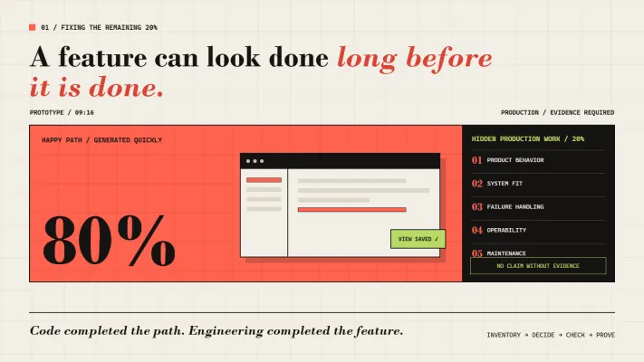
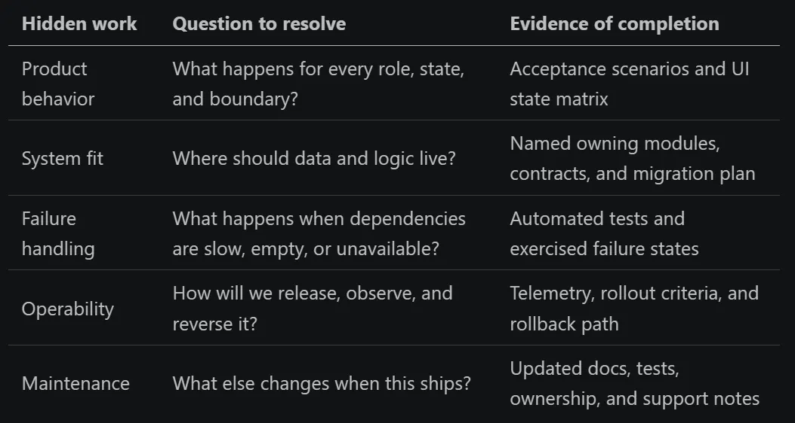
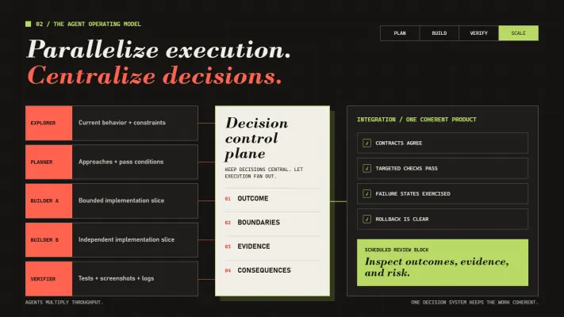
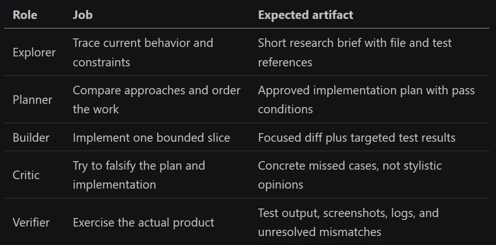

Picture a product team at 9:07 on a Tuesday morning.

A product manager asks an agent to add saved views to an internal dashboard. By 9:16, there is a new sidebar, a polished dialog, and a satisfying little animation when a view is saved. The happy path works. The team gathers around the screen, clicks through the demo, and has the same thought:

> We just built a feature before the first meeting of the day.

Then an engineer pulls the branch.

The saved view disappears after a refresh because it lives only in browser state. Two people can create views with the same name. Read-only users can see the delete button. The empty state breaks at narrow widths. There is no loading state, no telemetry, no migration, no keyboard navigation, and no decision about whether views belong to a person or a team.

The first 80% took nine minutes. The last 20% took two days.

The exact percentages vary, but the shape of the work does not. AI has collapsed the distance between an idea and running code. It has not collapsed the distance between running code and a feature that deserves to exist in production.

That gap is the work this article is about.

### The Prototype Is Becoming the Spec

The most visible change is not how quickly engineers type. It is who can express an idea in code.

A product manager can hand engineering a working interaction instead of a requirements document. A designer can ship a theme instead of annotating a Figma file. A support engineer can prototype the workflow customers keep asking for. This is a real expansion of creative power: the people closest to a problem can now make the first version tangible.

But a prototype answers only one question: is this roughly what we mean? It does not answer whether the data model is sound, the permissions are correct, the behavior is accessible, or the feature can be operated safely.

Treat the prototype as evidence of intent, not evidence of readiness. A useful prototype handoff should make four things legible:

1. Outcome: What becomes easier for the user?
2. Invariants: What must remain true about permissions, data, performance, and compatibility?
3. Acceptance: Which observable behaviors prove the feature works?
4. Disposability: Which parts demonstrate intent, and which parts are expected to survive?

That changes the review conversation. Instead of asking, "Can we merge this code?" the team asks, "What did this prototype teach us, and what is the smallest production-quality implementation of that lesson?"

### Fixing the Remaining 20


*Fixing the Remaining 20%*

The dangerous thing about agent-generated code is not that it is obviously bad. It is that the happy path arrives so quickly that the feature feels nearly finished.

The remaining work is rarely a pile of syntax. It is a pile of decisions:


*A pile of decisions*

Do not close that gap by repeatedly telling the agent to "finish the feature." That produces a sequence of plausible patches with no stable definition of done. Use a tighter loop instead:

1. Inventory before editing. Ask the agent to classify the feature as done, missing, or uncertain against the intended behavior.
2. Turn gaps into checks. Every missing item needs an observable pass condition: a test, screenshot, query result, accessibility check, or telemetry event.
3. Work in risk order. Settle data ownership, contracts, permissions, and migrations before polishing copy and animation.
4. Require evidence. A completion report should name the commands run, behaviors exercised, files changed, and risks still open.
5. Use the two-correction rule. On the first miss, narrow the gap and restate the pass condition. If the next attempt misses the same condition, stop patching and return to research. The agent is probably missing a constraint, not an instruction to try harder.

A practical recovery prompt looks like this:

```
Do not edit code yet. Compare the current implementation with the intended user outcome and repository conventions. Return:

1. what is complete;
2. what is missing;
3. what is ambiguous and needs a product or architecture decision;
4. the smallest ordered plan to close the gaps;
5. the exact evidence that will prove each step is complete.

Call out permissions, failure states, accessibility, telemetry, docs, rollout, and rollback explicitly. Wait for approval before implementing.
```

This is slower than asking for another patch. It is much faster than discovering the same missing decision in five different patches.

### Plan Until the Build Becomes Boring

The fastest AI-native contributors spend a surprising amount of time not generating code. Their reliable pattern is plan, build, verify, scale, and planning takes the largest share.

That does not mean writing a 40-page specification. It means resolving expensive ambiguity before the agent turns it into code. For a meaningful feature, the plan should answer:

- What user outcome are we changing?
- Where does the current behavior live?
- Which constraints cannot be violated?
- What are two or three viable approaches and their tradeoffs?
- Which files or systems should change, and which should not?
- How will we prove the result works?

Run research as its own step. Tell the agent not to edit. Ask it to trace the current behavior, find the owning abstraction, identify neighboring tests, and present alternatives. Then challenge the answer: What assumption would make this plan wrong? What is the cheapest check that could disprove it?

Only then write the implementation plan. A good plan is not a list such as "update frontend, update backend, add tests." It is a sequence of verifiable outcomes:

```
1. Define the saved-view ownership contract and cover personal/team permissions.
2. Persist views behind the existing dashboard repository interface.
3. Render loading, empty, success, conflict, and permission-denied states.
4. Add keyboard and screen-reader behavior to the dialog.
5. Emit create/use/delete events and document rollout and rollback.
6. Exercise the feature in the running product and capture evidence.
```

When those decisions are explicit, implementation becomes the least interesting part. That is a sign the plan is doing its job.

### Scale Without Multiplying Ambiguity

Back on the saved-views feature, imagine launching three agents before deciding who owns a view. The frontend builder stores views per user. The backend builder models them as team resources. The test writer assumes they are global fixtures. Each patch is locally coherent. Together, they cannot describe the same product.

Parallelism did not create the ambiguity. It multiplied it.


*Parallelism did not create the ambiguity. It multiplied it.*

Once the plan is strong, preserve the decisions that made it strong. Long agent threads accumulate stale hypotheses, failed attempts, terminal noise, and unrelated file contents. A larger context window delays this problem; it does not remove it.

Use separate agents as role boundaries, not as extra pairs of hands thrown at the same ambiguity:


*Separate agents as role boundaries*

Keep the main thread for decisions. Let explorer agents absorb broad file reading, builders own bounded changes, and verifiers collect noisy evidence. Pass concise artifacts between them rather than entire transcripts. The goal is not to maximize how many agents are active. It is to keep each agent's job understandable.

Ten agents can produce ten branches faster than one person can understand them. Without discipline, parallelism simply moves the bottleneck into review.

Use worktrees or isolated workspaces so agents do not overwrite one another. Split work along ownership boundaries with explicit contracts, not arbitrary groups of files. Appoint one integration owner for shared types, migrations, and cross-cutting decisions. Plan synchronously, run independent builds asynchronously, and review in scheduled blocks.

A workable rhythm is simple: make product and architecture decisions together, run bounded tasks in isolated workspaces, then review completed outcomes in batches before integrating them in dependency order.

Do not open every notification the moment an agent finishes. That feels responsive, but it turns the day into dozens of context switches. Batch the review work so your attention goes to the decisions that need it.

### Make the Engineering System the Supervisor

Return to the three obvious misses in the opening prototype. The view disappearing after refresh should become a persistence test. The delete button shown to read-only users should become a role-matrix test. The broken narrow layout should become a visual regression case at that viewport.

That is what it means to make the engineering system the supervisor: every surprise graduates from a review comment into a check the next agent cannot skip. More code throughput means more risk unless the system around the code improves with it. Every missing guardrail becomes a defect an agent can reproduce at machine speed.

The old fundamentals now carry more load:

- deterministic setup and fast, targeted tests;
- automated formatting, linting, type checking, and builds;
- preview environments with accessibility and visual checks;
- contract tests at service boundaries;
- telemetry and rollout checks in the definition of done;
- documentation updates triggered by behavior changes.

Verification should be part of the agent's assignment, not a cleanup task left for a human. Have it run the product, exercise important paths, capture screenshots at relevant viewports, inspect logs, and compare the result with the approved plan. Then let automation reject obvious failures before review.

Human review moves up a level. The important questions become:

1. Does this behavior belong in the product?
2. Does it fit the architecture and operating model?
3. Is the evidence strong enough to trust the change?
4. What is the cost of being wrong, and can we reverse it?

Line-level review still matters, especially for security and correctness. But when machines can produce more lines than people can inspect, decisions about boundaries, evidence, and consequences become the scarce resource.

### Change One Week of Work

Return to the dashboard team. The nine-minute prototype was not wasted effort. It made the interaction tangible and exposed questions a document might have hidden. The mistake was assuming that the visible 80% represented 80% of the delivery.

The team can change the next week without buying a new platform:

- Monday: Pick one active feature. Write its user outcome, evidence, smallest useful scope, explicit non-goals, and success measure.
- Tuesday: Run a no-code research pass and compare three implementation approaches.
- Wednesday: Define acceptance scenarios, failure states, and operational evidence before building.
- Thursday: Give separate builder and verifier agents bounded jobs in an isolated workspace.
- Friday: Review the evidence in one focused block, then turn every surprise into a reusable check.

For the dashboard team, Friday produces three durable assets: a refresh-persistence test, a read-only role case, and a narrow-viewport screenshot. The next feature begins with a stronger system than the previous one did.

The next advantage will not come from generating that first 80% a little faster. It will come from recognizing what the prototype has not decided and closing the last 20% deliberately.

The first 80% proves the idea can run. The last 20% proves the feature can survive reality.
