### How I built Sandcastle on the new GitHub Copilot provider for Microsoft Agent Framework — and what the feature actually unlocks

> ▶️ Live demo: [https://sandcastle.isainative.dev](https://sandcastle.isainative.dev/)

Most "AI app" demos boil down to the same thing: a prompt goes in, a wall of text comes out, and you still have to copy it, run it, fix the three things that don't compile, and host it. The [GitHub Copilot provider for Microsoft Agent Framework](https://learn.microsoft.com/en-us/agent-framework/agents/providers/github-copilot?pivots=programming-language-python) flips that: instead of returning text about code, an agent gets a real, sandboxed computer — it can run shell commands, read and write files, fetch URLs, and call MCP servers — and it uses that computer to actually build and run the thing you asked for.

Sandcastle is a showcase for exactly that. You type "build me a Pomodoro timer with a dark theme", and a team of Copilot agents — Planner → Builder → Fixer — scaffolds a real app in an isolated sandbox, runs it, self‑heals its own build errors, grounds itself in live Microsoft Learn docs, and streams a live preview you keep iterating on by chat. Every shell command and file write shows up in a live activity feed, tagged by which agent did it.

This article is a technical deep‑dive on both halves: what the provider gives you, and how Sandcastle is engineered to turn it into a spectator sport — including the auth model that lets a public demo run without ever spending a Copilot seat.

> 📐 Scope, on purpose. Sandcastle only ever builds static web frontend apps — a single index.html of vanilla HTML/CSS/JS that runs entirely in the browser, with no backend, no server processes, and no databases. That constraint is baked into the agent personas, and it's a feature rather than a shortcut: a static frontend is exactly the workload [Azure Static Web Apps' free tier](https://learn.microsoft.com/en-us/azure/static-web-apps/plans) is built for (global CDN, free SSL, custom domains, 100 GB bandwidth/month, 250 MB per app). Anything the demo builds, you can publish for free, as‑is. The demo is upfront about this — and about its inference limits — right on the home screen:

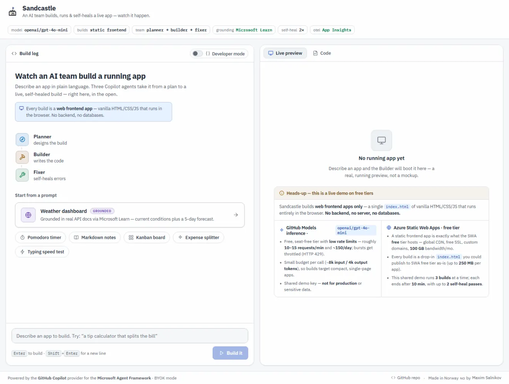

---

## Part 1 — The feature: an agent that does, not just says

### The 30‑second version

Microsoft Agent Framework can now use the [GitHub Copilot SDK/CLI](https://github.com/github/copilot-sdk) as an agent backend. In Python that's one package:

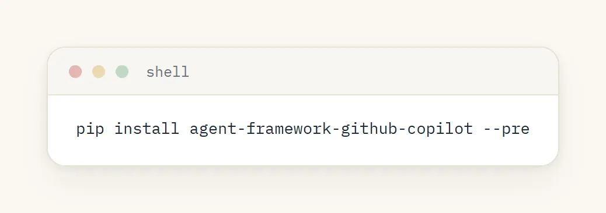

…and a handful of lines to a working agent:

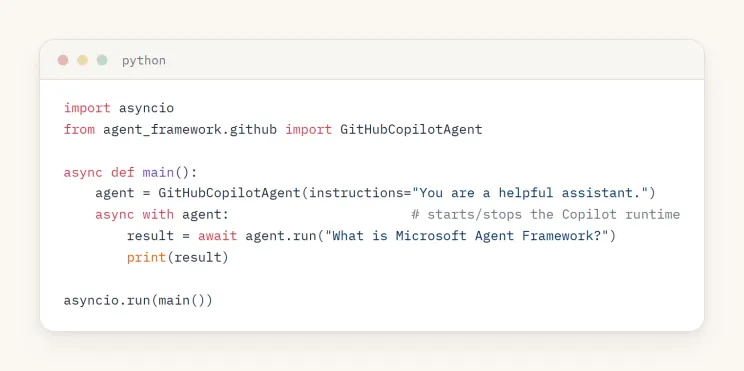

The GitHubCopilotAgent is a standard AIAgent, so everything else in Agent Framework — streaming, sessions, tools, tool approval, observability, workflows — works with it. What makes it special is the runtime underneath.

### What you actually get

A plain chat model can only emit tokens. The Copilot provider wraps a runtime that exposes agentic capabilities, gated by a permission handler you supply:

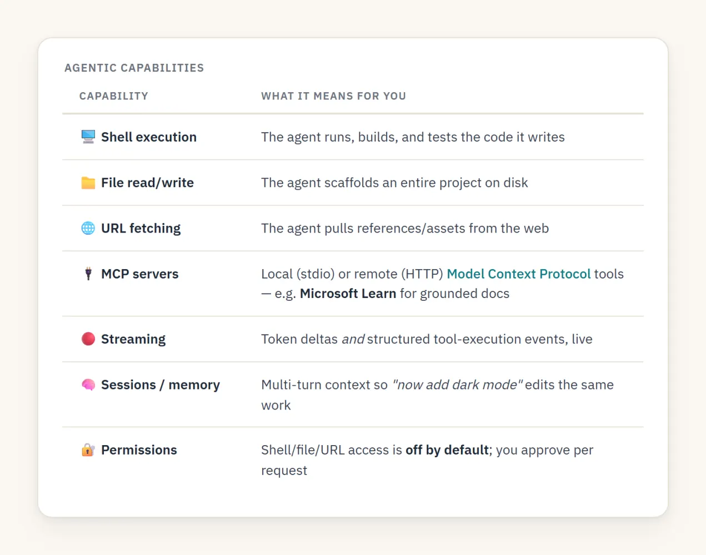

That permission gate is the whole ballgame for safety. By default the agent can't touch your shell or filesystem — you opt in via a handler. For a trusted sandbox you can approve everything; for anything sensitive you prompt a human. The docs are explicit: run agents that have shell/file permissions inside a container or Dev Container. Sandcastle takes that seriously (Part 3).

### Configuration knobs

The Python agent reads a small set of environment variables:

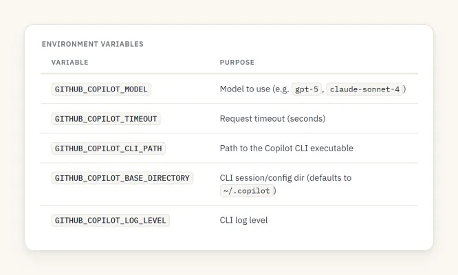

And per‑agent you can pass default\_options with model, mcp\_servers, on\_permission\_request, a custom provider (the BYOK escape hatch — Part 4), and more.

---

## Part 2 — The idea: make agentic coding a spectator sport

### A single agent that writes a file is neat. It becomes viral‑demo material when you:

1. Show the work. Stream every tool call and text delta so people watch the app get built.
2. Make it a team. Split the job into a Planner, a Builder, and a Fixer, each in its own visible lane.
3. Close the loop. Validate the output with a real signal and let the Fixer repair it until it's green — no human in the loop.
4. Hand back something live. Render the result in an iframe the user keeps iterating on by chat.

That's Sandcastle. Here's a real run — Planner and Builder streaming on the left, the validation banner going green, and the generated app rendering in the live preview on the right:

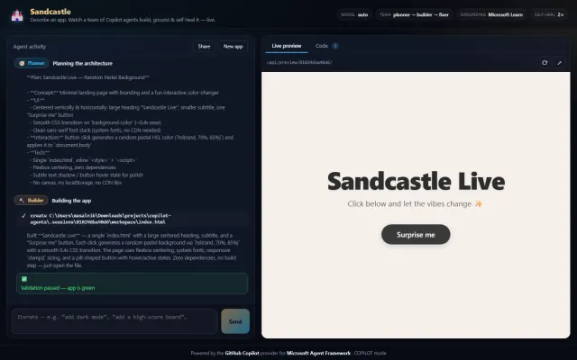

### System architecture

Two deployables, both on Azure free tiers: a React/Vite SPA on Static Web Apps, and a FastAPI backend on Container Apps whose image bundles Node 22 + @github/copilot.

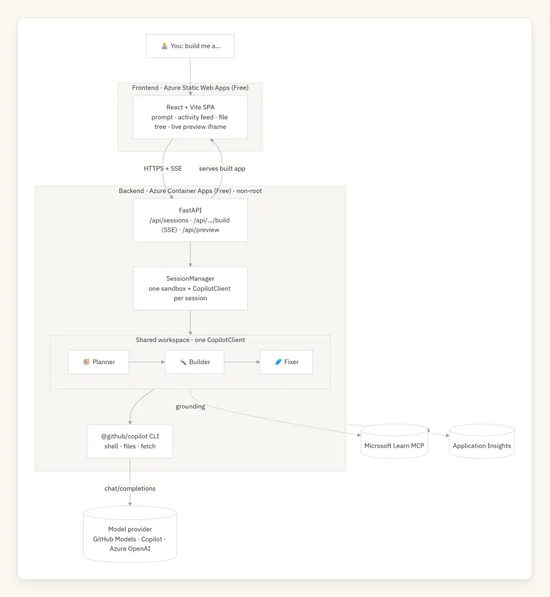

The core design decision: each session owns one scratch workspace and one CopilotClient; the three personas share it and run sequentially. Sharing one client means the Planner's plan, the Builder's files, and the Fixer's repairs all operate on the same directory — and running sequentially means every tool/text delta can be streamed live, tagged by agent, with no interleaving confusion.

---

## Part 3 — How it was built

### One sandbox, one client, three personas

The SessionManager creates a per‑session working directory, binds a CopilotClient to it, and stands up three GitHubCopilotAgent personas that share that client. They're kept alive across requests with an AsyncExitStack, and the Builder gets an AgentSession so "now add a leaderboard" edits the same app instead of starting over:

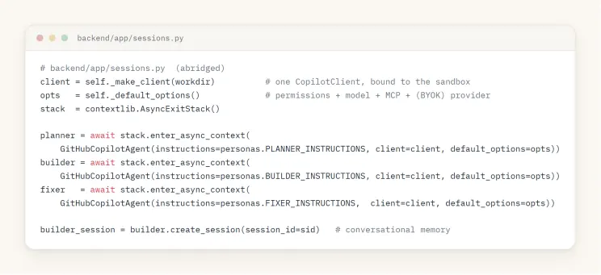

The default\_options are where permissions and grounding get wired in — PermissionHandler.approve\_all for the trusted sandbox, plus the Microsoft Learn HTTP MCP server for every agent:

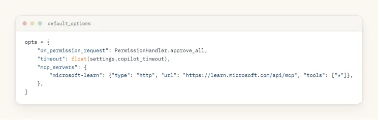

### Why a manual orchestrator (not the Workflow engine)

Agent Framework ships a WorkflowBuilder for multi‑agent orchestration. Sandcastle deliberately uses a hand‑written sequential loop instead — because the entire point of the demo is that you watch it happen. A manual loop lets every underlying Copilot tool/text delta stream straight to the UI, tagged with the lane that produced it:

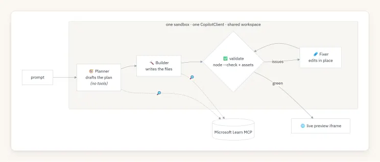

The three personas are just carefully written instruction prompts. The Planner emits a short plan and is told not to touch files. The Builder produces a complete, self‑contained index.html app and is told to edit in place when iterating. The Fixer receives a concrete list of validator problems and fixes exactly those without rewriting the app.

The loop that drives them is small enough to read in full:

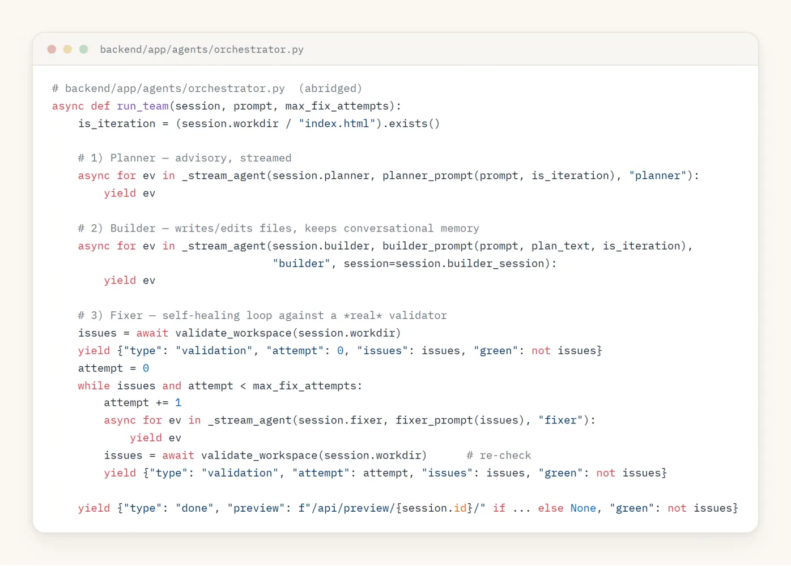

### Self‑healing on a real signal, not vibes

"Self‑healing" is only meaningful if the health check is real. Sandcastle's validator runs actual checks against the generated app and returns a list of concrete, human‑readable problems (an empty list means green):

- index.html must exist and be non‑trivial.
- Every inline and local \<script> is run through node --check (real JS syntax validation).
- Every locally referenced src/href asset must exist on disk.

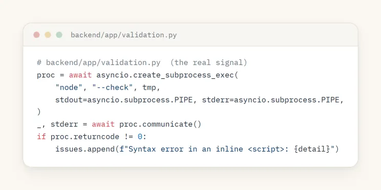

That output is fed verbatim to the Fixer, which edits in place; then the workspace is re‑validated. Repeat up to SANDCASTLE\_MAX\_FIX\_ATTEMPTS.

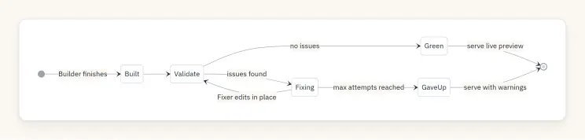

### Streaming everything: the SSE event model

The build endpoint is a Server‑Sent Events stream. Each AgentResponseUpdate from the Copilot runtime is mapped to a small, typed UI event — a tool starting, a tool finishing, a text delta, a usage record — and every event carries the agent lane so the UI can render three columns:

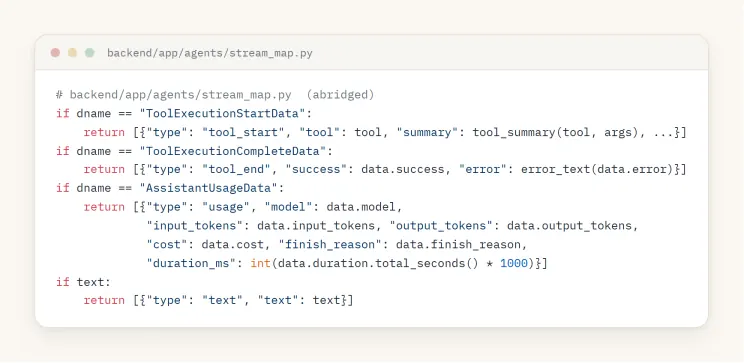

Put together, one build turn looks like this over the wire:

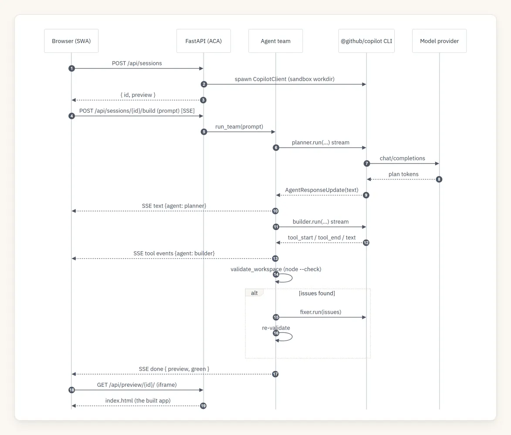

The frontend renders these as a live activity feed, a file tree with a source viewer, and the preview iframe.

### Developer mode: every token, tool call, and timing

Because the whole build is already a typed event stream, exposing it in full is a toggle, not a rewrite. Developer mode (top of the Build log) stops coalescing and streams every event into the feed — each one stamped with the elapsed time, the emitting agent, and its raw payload: status and phase transitions, per‑tool tool\_start/tool\_end with arguments, text deltas, and a rich usage row per agent turn (model, input/output tokens, cost, duration, finish\_reason). It turns the demo into a live, inspectable trace of what the Copilot runtime is actually doing.

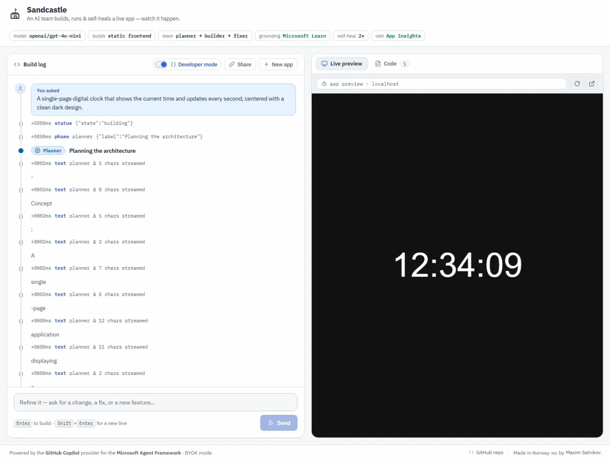

> One footgun worth calling out: a failed tool's data.error is a ToolExecutionCompleteError object, not a string — json.dumps chokes on it and kills the SSE stream mid‑build. The error\_text() helper coerces it to a string (with a default=str guard on the dump) so a broken build streams its error cleanly instead of hanging.

### Grounding in Microsoft Learn via MCP

Because MCP is first‑class in the provider, wiring live, authoritative docs into every agent is a few lines (shown above). When a request touches Microsoft/Azure/.NET tech, the Planner and Builder can call microsoft-learn-\* tools to consult current documentation instead of hallucinating an API. In one verified run, a "Dynamic Sessions cheat‑sheet" build made 8 Microsoft Learn lookups and produced grounded, accurate content.

---

## Part 4 — The auth model everyone gets wrong (and the seat‑free trick)

Here's the question that decides whether your Copilot‑powered app can be a public demo: whose credentials pay for inference?

The GitHub Copilot provider is licensed per user. Point it at your own token and it's perfect for local dev — but a public URL that injects your token spends your seat on every visitor. The fix is to separate the two planes the provider actually has:

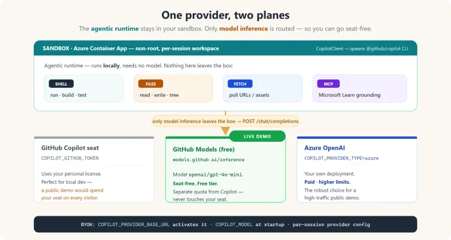

The agentic runtime (shell, files, URL fetch, MCP) always runs locally in your sandbox — it needs no model and spends no tokens. Only model inference is routed. So you can keep all the agentic superpowers and swap just the inference target to something seat‑free.

That's BYOK (bring‑your‑own‑key), activated when you set COPILOT\_PROVIDER\_BASE\_URL. Sandcastle's live demo routes inference to the free GitHub Models endpoint (https://models.github.ai/inference, model openai/gpt-4o-mini) — a separate quota from the Copilot seat, so the public demo never touches one.

### The two‑layer BYOK contract (the part that bites everyone)

Getting env‑only BYOK working took discovering two non‑obvious requirements. Both are now handled in sessions.py:

1) The CLI needs an explicit model at startup. Setting GITHUB\_COPILOT\_MODEL (a per‑session framework setting) is not enough — the CLI process itself exits with "BYOK providers require an explicit model" unless COPILOT\_MODEL is present in its environment. Also note: CopilotClient(env=…) replaces the process environment, so you must start from os.environ and layer the provider vars on top (or the CLI loses PATH/COPILOT\_HOME):

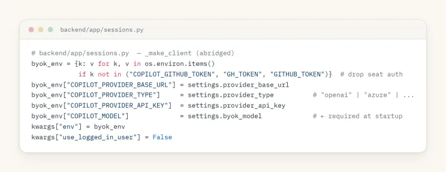

2) Each session must be created with a provider config. Process‑level env alone isn't enough for the session RPC — without it you get "Session was not created with authentication info or custom provider." So the per‑agent default\_options also carries a provider block:

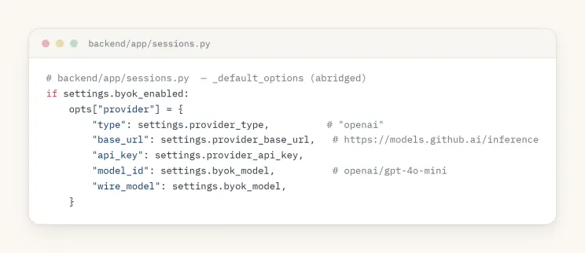

Do both and BYOK "just works." For a high‑traffic public demo you'd point the same two settings at Azure OpenAI (COPILOT\_PROVIDER\_TYPE=azure, host URL only) for higher limits — one config change, zero code change.

> TL;DR of the auth model: the demo you're looking at runs its agents with full shell/file powers and spends no Copilot seat, because only inference is routed — to a free, separate‑quota endpoint.

---

## Part 5 — Hardening the sandbox

Running an agent with approve\_all means containment is the security boundary. Sandcastle's hosted profile applies defense‑in‑depth:

- Non‑root container, per‑session scratch dir, workspace cleanup on session close.
- Concurrency cap and session timeouts (single replica keeps the in‑memory session map correct).
- A per‑client sliding‑window rate limiter (X‑Forwarded‑For aware) → 429 + Retry‑After on session creation (per hour) and builds (per minute).
- Output caps: SSE frames truncate oversized fields with a total‑event cap; the file endpoint enforces a max byte size + nosniff; the preview server is path‑traversal guarded.

A stronger isolation upgrade is a drop‑in: Azure Container Apps Dynamic Sessions (Hyper‑V isolated) or the Copilot CLI's native --sandbox.

---

## Part 6 — Observability for free

Because GitHubCopilotAgent is a standard Agent Framework agent, OpenTelemetry works out of the box. Sandcastle calls configure\_otel\_providers() once at startup, so every agent invocation, tool call, and model request is traced with gen\_ai.\* attributes (including token usage). The exporter auto‑selects the first available of Azure Application Insights → OTLP → console → disabled — all defensive, sensitive telemetry off by default:

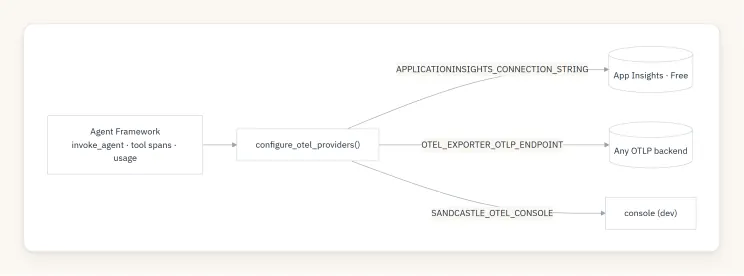

---

## Part 7 — Deploying on Azure free tiers

The whole thing runs on free grants: Static Web Apps (Free) for the SPA and Container Apps (Free, scale‑to‑zero) for the backend, provisioned by Bicep, shipped by GitHub Actions on push to main using OIDC (no long‑lived cloud secrets):

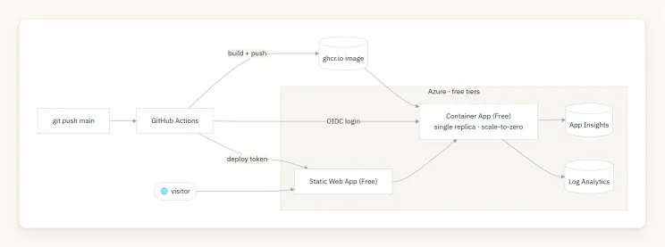
*Azure deployment topology (free tiers)*

Scale‑to‑zero has one visible cost: the first request after idle takes ~20–30s to cold‑start the agent runtime, then it's fast. A single replica is a deliberate choice — it keeps the in‑memory session map and rate limiter correct without a shared store.

---

### Lessons worth stealing

- The runtime is local; only inference is remote. Internalizing that split is what unlocks a compliant public demo — full agentic powers, zero Copilot seats spent.
- BYOK has a two‑layer contract: COPILOT\_MODEL at CLI startup and a per‑session provider config. Miss either and you get cryptic errors. CopilotClient(env=…) replaces the environment — build it from os.environ.
- Stream the raw deltas. A manual orchestrator beats a black‑box workflow engine when the demo is the visibility. Map AgentResponseUpdate → typed UI events and tag by agent.
- Self‑healing needs a real oracle. node --check + asset existence is a cheap, high‑signal validator that turns "self‑healing" from a buzzword into a loop that actually converges.
- Permissions + containers are the safety story. Default‑deny permissions plus a non‑root, rate‑limited, path‑guarded sandbox is the minimum bar for approve\_all.

---

### Build your own

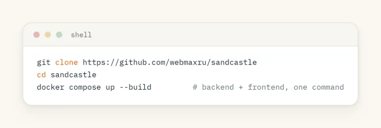
*Clone and run Sandcastle*

- Live demo: [https://sandcastle.isainative.dev](https://sandcastle.isainative.dev/)
- Source: [https://github.com/webmaxru/sandcastle](https://github.com/webmaxru/sandcastle)
- The feature: [GitHub Copilot provider for Microsoft Agent Framework](https://learn.microsoft.com/en-us/agent-framework/agents/providers/github-copilot?pivots=programming-language-python)
- GitHub Models (free inference): [https://github.com/marketplace/models](https://github.com/marketplace/models)

The most compelling thing about the Copilot provider isn't any single capability — it's that an agent stops being a text generator and becomes a teammate with a computer. Sandcastle just puts a window on that. Go describe an app and watch a team build it.
