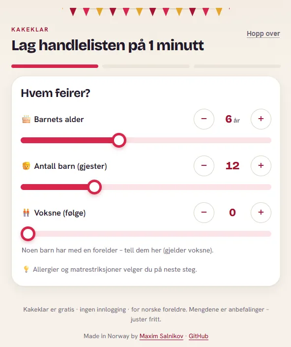
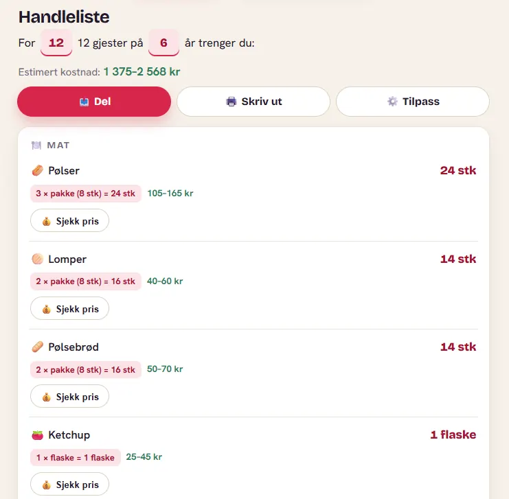
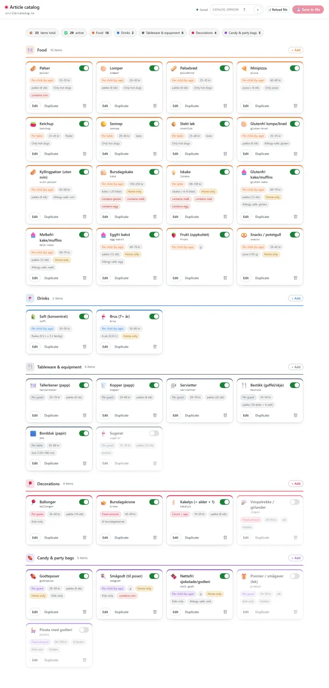
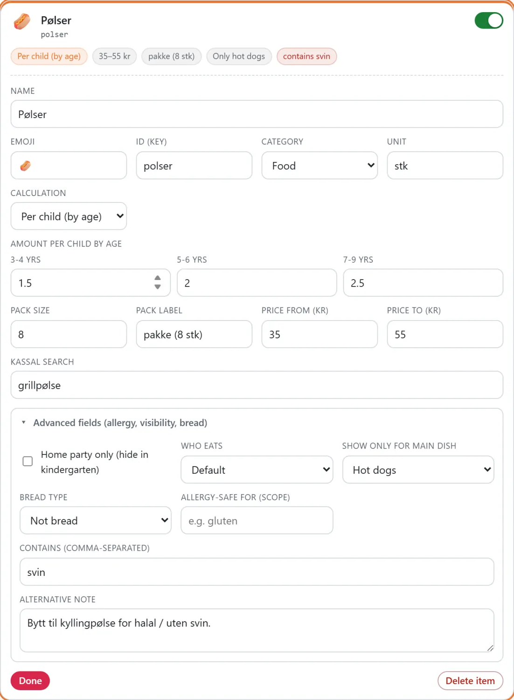
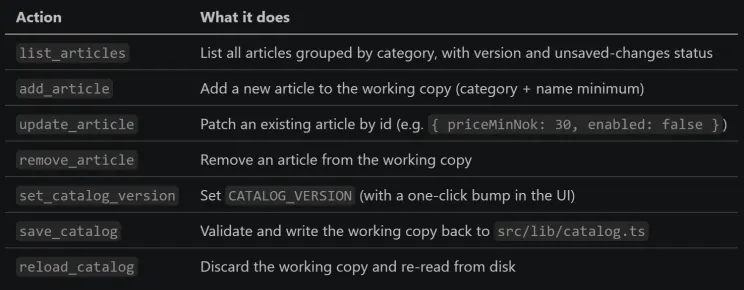

The teams getting the most out of AI agents are not the ones with the best model. They are the ones building a custom layer on top of it. This is a short, hands-on look at one new surface for that layer - GitHub Copilot app's Canvas - learned by building a small internal tool end to end.

There is a quiet shift happening in how serious engineering organizations adopt AI, and most of the public conversation is still looking the wrong way. The headlines are about which model is in the lead this month. The actual differentiation is somewhere else entirely: in the bespoke layer teams build around the agent.

Internal harnesses. Custom developer tools. Evaluation suites. Guardrails. Purpose-built surfaces tuned to exactly how a given team works. None of that is the model. All of it is increasingly where the advantage - and the IP - accrues. Two companies can run the identical model and ship wildly different velocity, because one of them invested in the scaffolding that makes the agent fluent in their codebase, their conventions, their workflows.

I wanted hands-on intuition for one piece of that scaffolding, so I ran a small experiment. This post is the story of it: what GitHub Copilot Canvas is, why it is a natural surface for the custom-tooling layer, and what I learned building one real (if delightfully silly) internal tool on a side project of mine.

```
⚡ Afterthought (added after publishing): I came up with my own definition of Canvas feature: it's a meta harness. It's a harness in its own right (as part of GitHub Copilot), but it also streamlines the creation of an external engineering harness layer, ranging from simple interactive surfaces embedded within a solution (like in my example below) to sophisticated dashboards and control planes that connect agents, work artifacts, and more.
```

### The pattern: the harness is the advantage

Step back from any single feature for a moment and look at the shape of how high-performing teams are actually using coding agents.

The model sits in the middle, commoditizing fast. Around it, teams are assembling a layer that the model alone does not give you:

- Context and memory - the project knowledge, conventions, and house style the agent should always have.
- Tools and integrations - the specific actions the agent can take in your systems.
- Evals and guardrails - the checks that make agent output trustworthy enough to ship.
- Surfaces - the places where humans and the agent actually do the work together, beyond a chat transcript.

That last category is the one I think is most underrated, and it is the one Canvas lands in. A chat box is a general-purpose interface; it is wonderful for expressing intent and terrible as a home for recurring, structured work. The teams pulling ahead are the ones building task-shaped surfaces - a triage board, a release dashboard, an editor for some structured artifact - that turn "re-explain it to the agent every time" into "open the tool and work."

Here is the strategic point: those surfaces are not throwaway. They encode how your team operates. They are cheap to build now and expensive for a competitor to copy, because the value is in the fit, not the framework. That is what makes the harness an asset rather than an expense.

You do not learn the feel of that by reading about it. So I went looking for a low-stakes way to build one.

### Where Canvas fits

If you have only ever used Copilot as a chat box, this is the part worth slowing down for, because Canvas is exactly the "custom surface" primitive the section above is gesturing at.

A canvas extension is a shared, interactive surface for a work artifact - a plan, a triage board, a dashboard, a checklist, a document, or some structured config. The [GitHub docs](https://docs.github.com/en/copilot/how-tos/github-copilot-app/working-with-canvas-extensions) put it well:

```
While chat is useful for defining intent and discussing tasks, most work happens in work surfaces such as a terminal, a browser, a document, or a dashboard. Canvases allow you to collaborate with the agent directly in those work surfaces.
```

The key word is 𝗯𝗶𝗱𝗶𝗿𝗲𝗰𝘁𝗶𝗼𝗻𝗮𝗹. A canvas is not a read-only preview the agent renders at you. The agent can update it while it works, 𝘢𝘯𝘥 you can edit the same surface directly with your mouse. When you create one, the agent generates 𝗮𝗴𝗲𝗻𝘁-𝗰𝗮𝗹𝗹𝗮𝗯𝗹𝗲 𝗰𝗮𝗽𝗮𝗯𝗶𝗹𝗶𝘁𝗶𝗲𝘀 (think 𝚐𝚎𝚝\_𝚋𝚘𝚊𝚛𝚍, 𝚊𝚍𝚍\_𝚌𝚊𝚛𝚍, 𝚖𝚘𝚟𝚎\_𝚌𝚊𝚛𝚍) so chat and UI stay in sync over one shared state. Canvases open in the app's right-hand side panel and can be 𝗽𝗿𝗼𝗷𝗲𝗰𝘁-𝘀𝗰𝗼𝗽𝗲𝗱 (committed to the repo, shared with the team via .𝚐𝚒𝚝𝚑𝚞𝚋/𝚎𝚡𝚝𝚎𝚗𝚜𝚒𝚘𝚗𝚜) or 𝘂𝘀𝗲𝗿-𝘀𝗰𝗼𝗽𝗲𝗱 (personal, in ~/.𝚌𝚘𝚙𝚒𝚕𝚘𝚝/𝚎𝚡𝚝𝚎𝚗𝚜𝚒𝚘𝚗𝚜).

Read that "project-scoped, committed to the repo" line again with the harness argument in mind. A canvas is not just a UI; it is a custom tool you can version, review, and ship to your whole team like any other code. That is precisely the property that turns a one-off surface into part of your durable engineering layer.

### Key scenarios the docs call out

Canvas shines when a task needs 𝘀𝘁𝗿𝘂𝗰𝘁𝘂𝗿𝗲, 𝗶𝘁𝗲𝗿𝗮𝘁𝗶𝗼𝗻, 𝗮𝗻𝗱 𝘃𝗲𝗿𝗶𝗳𝗶𝗰𝗮𝘁𝗶𝗼𝗻 and a chat transcript is not enough. The docs highlight a few patterns:

- 𝗔𝗴𝗲𝗻𝘁𝗶𝗰 𝗸𝗮𝗻𝗯𝗮𝗻 𝗯𝗼𝗮𝗿𝗱𝘀 - humans and agents add cards, move work, and kick off tasks from one board.
- 𝗜𝘀𝘀𝘂𝗲 𝘁𝗿𝗶𝗮𝗴𝗲 𝗯𝗼𝗮𝗿𝗱𝘀 - summarize top issues, recurring themes, and user pain points for a repo.
- 𝗠𝗮𝗿𝗸𝗱𝗼𝘄𝗻 𝗰𝗮𝗻𝘃𝗮𝘀𝗲𝘀 - a persistent planning surface for your day: issues, PRs, and agent sessions in one editable file.
- 𝗗𝗼𝗰𝘂𝗺𝗲𝗻𝘁 𝗰𝗮𝗻𝘃𝗮𝘀𝗲𝘀 - open and edit documents, spreadsheets, and slide decks right in the app.

My use case is none of those exactly - and that is the point. A canvas is a surface 𝘺𝘰𝘶 𝘴𝘩𝘢𝘱𝘦 𝘵𝘰 𝘺𝘰𝘶𝘳 𝘸𝘰𝘳𝘬𝘧𝘭𝘰𝘸. Mine happened to be "give a TypeScript config file a friendly face."

### Why I experimented on a birthday-party app

To learn a new surface honestly, you want a real problem - real enough that the rough edges show up - but low enough stakes that you can move fast and throw things away. A side project is perfect. Mine happened to be about cake.


*Kakeklar.no*

[Kakeklar](https://kakeklar.no/) (Norwegian for roughly "cake-ready") is a free, no-login, mobile-first planner for kids' birthday parties - 𝘣𝘢𝘳𝘯𝘦𝘣𝘶𝘳𝘴𝘥𝘢𝘨. A Norwegian parent answers two questions on a slider - 𝗵𝗼𝘄 𝗺𝗮𝗻𝘆 𝗸𝗶𝗱𝘀 and 𝗵𝗼𝘄 𝗼𝗹𝗱 𝗶𝘀 𝘁𝗵𝗲 𝗯𝗶𝗿𝘁𝗵𝗱𝗮𝘆 𝗰𝗵𝗶𝗹𝗱 - and the app produces a complete, age-aware shopping list plus a printable checklist and a planning timeline.


*Part of the shopping list*

Behind that cheerful slider is real math. A 4-year-old eats fewer sausages than a 9-year-old, some items are "per child" while others are "per table" or a fixed amount, packs come in fixed sizes (sausages in packs of 8), and some items are home-party-only or allergy-sensitive. The output is a categorized list - 𝗠𝗮𝘁 (food), 𝗗𝗿𝗶𝗸𝗸𝗲 (drinks), 𝗦𝗲𝗿𝘃𝗶𝘀𝗲 & 𝘂𝘁𝘀𝘁𝘆𝗿 (tableware), 𝗣𝘆𝗻𝘁 (decorations), 𝗚𝗼𝗱𝘁𝗲𝗿𝗶 & 𝗽𝗼𝘀𝗲𝗿 (candy and party bags) - with quantities, pack math, price ranges, and a "Sjekk pris" (check price) button.

Every single line in that list is driven by one data file: 𝚜𝚛𝚌/𝚕𝚒𝚋/𝚌𝚊𝚝𝚊𝚕𝚘𝚐.𝚝𝚜. Thirty-three articles, each with a dozen fields - emoji, unit, calculation mode, per-age amounts, pack size, price range, allergy info, visibility flags. It is the heart of the product. And it was editable by exactly one person.

That is why it was a good sandbox. The tool I needed for it is small, but the pattern is not.

### The concrete experiment: a custom internal tool in an afternoon

Here's the honest truth: right now I'm the only maintainer. But I do not want it to stay that way - I would love for other people to contribute. I want to open up what goes into that catalog, both to other developers and, honestly, to a couple of non-developer friends who actually throw a lot of kids' parties. At the same time, I intentionally do not want to build a full-scale catalog management system - no admin dashboard, no database, no user accounts and roles. The catalog is a single TypeScript file, the app stays stateless, and I want it to stay that simple. The questions I want help with are product questions, not code questions:

- Should we add gluten-free cake as its own article?
- Is 2 sausages per 7-year-old too many?
- What is a realistic 2024 price range for paper plates?

But every one of those answers required someone to:

1. Open 𝚜𝚛𝚌/𝚕𝚒𝚋/𝚌𝚊𝚝𝚊𝚕𝚘𝚐.𝚝𝚜.
2. Find the right object in a 300-line array.
3. Edit a field 𝘸𝘪𝘵𝘩𝘰𝘶𝘵 breaking TypeScript syntax.
4. Remember to bump 𝙲𝙰𝚃𝙰𝙻𝙾𝙶\_𝚅𝙴𝚁𝚂𝙸𝙾𝙽 so cached copies invalidate.
5. Run the build to make sure nothing broke.

That is five chances to introduce a bug for a one-word change. The status quo cost was real: either I stay the bottleneck for every catalog tweak, or I hand a would-be contributor a loaded footgun. Neither one invites anybody in.

What I wanted was dead simple to describe and annoying to build by hand: 𝗮 𝗰𝗮𝗿𝗱-𝗯𝗮𝘀𝗲𝗱 𝗲𝗱𝗶𝘁𝗼𝗿, 𝗴𝗿𝗼𝘂𝗽𝗲𝗱 𝗯𝘆 𝗰𝗮𝘁𝗲𝗴𝗼𝗿𝘆, 𝘄𝗵𝗲𝗿𝗲 𝘆𝗼𝘂 𝗰𝗮𝗻 𝗮𝗱𝗱, 𝗲𝗱𝗶𝘁, 𝗿𝗲𝗺𝗼𝘃𝗲, 𝗮𝗻𝗱 𝘁𝗼𝗴𝗴𝗹𝗲 𝗮𝗿𝘁𝗶𝗰𝗹𝗲𝘀 - 𝗮𝗻𝗱 𝗵𝗮𝘃𝗲 𝗶𝘁 𝘄𝗿𝗶𝘁𝗲 𝘃𝗮𝗹𝗶𝗱 𝗧𝘆𝗽𝗲𝗦𝗰𝗿𝗶𝗽𝘁 𝗯𝗮𝗰𝗸 𝘁𝗼 𝘁𝗵𝗲 𝗳𝗶𝗹𝗲.

### The solution: an "Article catalog" canvas

I opened a session in the Copilot app and used the /𝚌𝚛𝚎𝚊𝚝𝚎-𝚌𝚊𝚗𝚟𝚊𝚜 skill. I described the workflow in plain language:

```
a card UI for the party catalog, grouped by configured category, easy to add / remove / edit, that reads and writes 𝚜𝚛𝚌/𝚕𝚒𝚋/𝚌𝚊𝚝𝚊𝚕𝚘𝚐.𝚝𝚜.
```

The agent scaffolded the extension, wired up the capabilities, and opened it in the side panel.

Here is what came out the other side:


*Article catalog*

Every article is a 𝗰𝗮𝗿𝗱. Each card shows its emoji and name, its 𝚒𝚍 key, the calculation mode ("Per child by age", "Per table", "Per guest", "Fixed amount", "Count = age"), the price range, pack info, and badges for allergy and visibility rules. A toggle in the corner enables or hides the item. The header tracks totals - 𝟯𝟯 𝗶𝘁𝗲𝗺𝘀, 𝟮𝟵 𝗮𝗰𝘁𝗶𝘃𝗲 - and a per-category breakdown. There is a + 𝙰𝚍𝚍 button on every category, an inline 𝙲𝙰𝚃𝙰𝙻𝙾𝙶\_𝚅𝙴𝚁𝚂𝙸𝙾𝙽 field with a one-click bump, a 𝗥𝗲𝗹𝗼𝗮𝗱 𝗳𝗶𝗹𝗲 button, and a 𝗦𝗮𝘃𝗲 𝘁𝗼 𝗳𝗶𝗹𝗲 button that lights up only when there are unsaved changes.

Click 𝗘𝗱𝗶𝘁 and the card expands into a full inline form - no modal, no separate page:


*Article editing*

Notice the deliberate split: 𝘁𝗵𝗲 𝗨𝗜 𝗰𝗵𝗿𝗼𝗺𝗲 𝗶𝘀 𝗘𝗻𝗴𝗹𝗶𝘀𝗵, 𝘁𝗵𝗲 𝗰𝗮𝘁𝗮𝗹𝗼𝗴 𝗱𝗮𝘁𝗮 𝘀𝘁𝗮𝘆𝘀 𝗡𝗼𝗿𝘄𝗲𝗴𝗶𝗮𝗻. Labels like "Amount per child by age" and "Advanced fields (allergy, visibility, bread)" are in English so a contributor from anywhere can use the tool, but the article names (𝙿𝚘𝚕𝚜𝚎𝚛, 𝙻𝚘𝚖𝚙𝚎𝚛, 𝙱𝚞𝚛𝚜𝚍𝚊𝚐𝚜𝚔𝚊𝚔𝚎) and their notes (𝙱𝚢𝚝𝚝 𝚝𝚒𝚕 𝚔𝚢𝚕𝚕𝚒𝚗𝚐𝚙𝚘𝚕𝚜𝚎 𝚏𝚘𝚛 𝚑𝚊𝚕𝚊𝚕 / 𝚞𝚝𝚎𝚗 𝚜𝚟𝚒𝚗) remain in the app's real language. That was a conscious decision: the 𝘵𝘰𝘰𝘭 is for contributors, the 𝘤𝘰𝘯𝘵𝘦𝘯𝘵 is for Norwegian parents.

The headline number from the experiment: from "one sentence of intent" to "a working, custom internal tool committed to the repo" was an afternoon, not a sprint.

### Technical deep dive: the reusable patterns

This is the part worth keeping even if you never touch a birthday-party app, because the same three patterns show up in basically any serious internal tool you would build on this surface.

The whole extension is project-scoped at .𝚐𝚒𝚝𝚑𝚞𝚋/𝚎𝚡𝚝𝚎𝚗𝚜𝚒𝚘𝚗𝚜/𝚊𝚛𝚝𝚒𝚌𝚕𝚎-𝚌𝚘𝚗𝚏𝚒𝚐/ - so it is committed to the repo and anyone who clones the project gets it automatically. It is plain Node ESM plus a tiny vanilla-JS front end; no build step, no framework.

Pattern 1: capabilities make the tool agent-native

Because a canvas is bidirectional, the same catalog is editable from chat. The extension exposes seven agent-callable actions:


*Capabilities the agent can call*

So I can 𝘤𝘭𝘪𝘤𝘬 to add a gluten-free cake, or I can type "add a gluten-free chocolate muffin to Food, 49 to 79 kr, home-party only" and the agent calls 𝚊𝚍𝚍\_𝚊𝚛𝚝𝚒𝚌𝚕𝚎. Both paths land in the same place.

Pattern 2: the working-copy safety net

The single most important design decision: 𝗲𝗱𝗶𝘁𝘀 𝗹𝗶𝘃𝗲 𝗶𝗻 𝗮𝗻 𝗶𝗻-𝗺𝗲𝗺𝗼𝗿𝘆 𝘄𝗼𝗿𝗸𝗶𝗻𝗴 𝗰𝗼𝗽𝘆 𝗮𝗻𝗱 𝗼𝗻𝗹𝘆 𝘁𝗼𝘂𝗰𝗵 𝗱𝗶𝘀𝗸 𝗼𝗻 𝗦𝗮𝘃𝗲. Nothing you do in the canvas - typing, toggling, adding, the agent patching a field - writes to 𝚌𝚊𝚝𝚊𝚕𝚘𝚐.𝚝𝚜 until someone hits 𝗦𝗮𝘃𝗲 𝘁𝗼 𝗳𝗶𝗹𝗲 (or the agent calls 𝚜𝚊𝚟𝚎\_𝚌𝚊𝚝𝚊𝚕𝚘𝚐). That means:

- You can experiment freely and 𝗥𝗲𝗹𝗼𝗮𝗱 𝗳𝗶𝗹𝗲 to throw it all away.
- The Git working tree stays clean while you tinker, so diffs are intentional.
- 𝚜𝚊𝚟𝚎\_𝚌𝚊𝚝𝚊𝚕𝚘𝚐 𝘃𝗮𝗹𝗶𝗱𝗮𝘁𝗲𝘀 𝗶𝗱𝘀 𝗮𝗻𝗱 𝗰𝗮𝘁𝗲𝗴𝗼𝗿𝗶𝗲𝘀 𝗳𝗶𝗿𝘀𝘁, then regenerates the whole file grouped by category - so the output is always well-formed TypeScript, never a half-applied hand edit.

Pattern 3: one shared state, many doors

A canvas has two editors - you and the agent - plus potentially two open panels. The extension uses 𝘀𝗲𝗿𝘃𝗲𝗿-𝘀𝗲𝗻𝘁 𝗲𝘃𝗲𝗻𝘁𝘀 to push state changes to every connected surface, with a "dirty" indicator and a conflict banner if the working copy changes underneath you. When the agent calls 𝚞𝚙𝚍𝚊𝚝𝚎\_𝚊𝚛𝚝𝚒𝚌𝚕𝚎 from chat, your open card grid updates live. When you toggle a card, the agent's next 𝚕𝚒𝚜𝚝\_𝚊𝚛𝚝𝚒𝚌𝚕𝚎𝚜 sees it. One shared state, many doors into it.

One gotcha worth writing down

The extension resolves the repo root with 𝚙𝚊𝚝𝚑.𝚛𝚎𝚜𝚘𝚕𝚟𝚎(\_\_𝚍𝚒𝚛𝚗𝚊𝚖𝚎, "..", "..", "..") rather than the session's workspace path. In the Copilot app, the session path points at a session-state directory, 𝘯𝘰𝘵 the repo - so the naive choice would have written 𝚌𝚊𝚝𝚊𝚕𝚘𝚐.𝚝𝚜 into the wrong place. If you build a canvas that reads or writes repo files, double-check what "root" means in your runtime.

### What the experiment taught me about the bigger picture

The small tool worked. More useful than the tool, though, was the calibration it gave me on the strategic claim I started with. A few things became concrete:

- The cost curve has genuinely changed. A custom, agent-native, repo-committed internal tool used to be a "we should staff that" project. Describing it in a sentence and having a working version in an afternoon moves it into "just build it" territory. When the cost of a bespoke surface drops by an order of magnitude, the rational amount of bespoke tooling a team should own goes up.
- The surface is where the leverage compounds. The capabilities I defined are reusable by the agent forever. Every future "add this, change that" is now a one-liner the agent executes against a validated writer, not a hand edit. That is the harness paying dividends.
- Shippable beats personal. Because the canvas is project-scoped and committed, it is not my private convenience - it is part of the project. Anyone who opens the repo gets the tool. That is the property that turns individual cleverness into team capability, which is the whole game at organizational scale.

None of this is specific to cake. Point the same approach at the artifact in your stack that only one person dares touch, and the math is the same.

### What I would build next

Staying in the spirit of "the harness is the product," the next increments are all about trust and reach:

- Inline validation hints - warn when a required field is missing right where you are editing, so the tool teaches its own rules.
- A diff preview before Save - show the exact change the canvas is about to write, so a reviewer can sanity-check a batch of edits. (At company scale this is the gateway to letting more people edit safely.)
- Live data lookups inside the editor - pull a current reference value (a price, a usage stat) into the card so the content stays honest over time.

Each one is small. Together they are the difference between "a form that writes a file" and "an internal tool people reach for."

### Takeaways

If there is one idea to carry out of here, it is this: stop evaluating AI adoption only by the model, and start evaluating it by the layer you are willing to build around the agent. That layer - context, tools, evals, and especially custom surfaces - is where teams will separate, because it encodes how you work and that is the thing competitors cannot copy off a leaderboard.

Canvas is one concrete, surprisingly low-friction way to build a piece of that layer. I described an internal tool in one sentence and had it committed to my repo by the end of an afternoon, with the agent able to drive it as fluently as I can. The artifact I built happens to manage sausages and cake; the pattern manages anything structured.

Chat tells the agent what you want. A canvas is where the work lives - and increasingly, where your advantage does too.

𝗧𝗿𝘆 𝗶𝘁 𝘆𝗼𝘂𝗿𝘀𝗲𝗹𝗳:

- The live app: [https://kakeklar.no/](https://kakeklar.no/)
- Canvas extensions docs: [https://docs.github.com/en/copilot/how-tos/github-copilot-app/working-with-canvas-extensions](https://docs.github.com/en/copilot/how-tos/github-copilot-app/working-with-canvas-extensions)
- Start your own with the /𝚌𝚛𝚎𝚊𝚝𝚎-𝚌𝚊𝚗𝚟𝚊𝚜 skill inside a Copilot app session.

### Over to you 💬

I am convinced the custom layer around the agent is where the next few years of engineering advantage gets decided. I am much less sure I have the map of which surfaces matter most - so I want to hear from the people building them.

Drop a comment and tell me:

- Have you tried Canvas in the Copilot app yet? If so, what did you build, and did it stick - or did you go back to chat-only? I want the honest version, including the ones that did not work out.
- Is "custom tooling on top of the agent" already on your roadmap - a real line item with someone's name on it - or still a someday? What is blocking it?
- Which use case would you most want a canvas for? A few that I keep coming back to, to get you started:A content/CMS editor over a Markdown or JSON content folder.A test-case matrix you can fill in as cards instead of hand-writing fixtures.A prompt/eval library where non-engineers tweak prompts and the agent keeps the file valid.A release-notes board that compiles commits into a structured changelog you can rearrange.A design-tokens panel over your CSS variables (I am half-tempted to build this next for Kakeklar).

If even one of these makes you think "we could build that for our thing this quarter" - that was exactly my reaction, and it is worth chasing. Tell me which one.

And if you would rather build than comment: the [Kakeklar repo is open](https://github.com/webmaxru/barnebursdag-planlegger), the canvas is in there, and pull requests - in Norwegian or in code - are very welcome.
