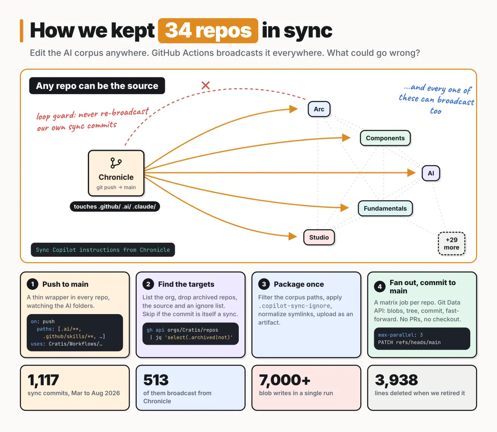
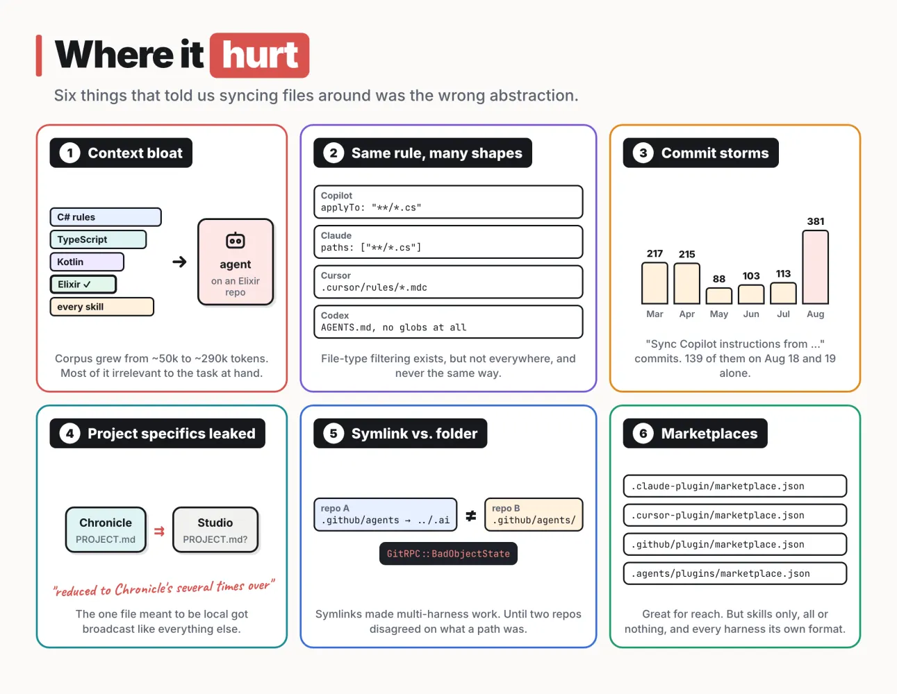
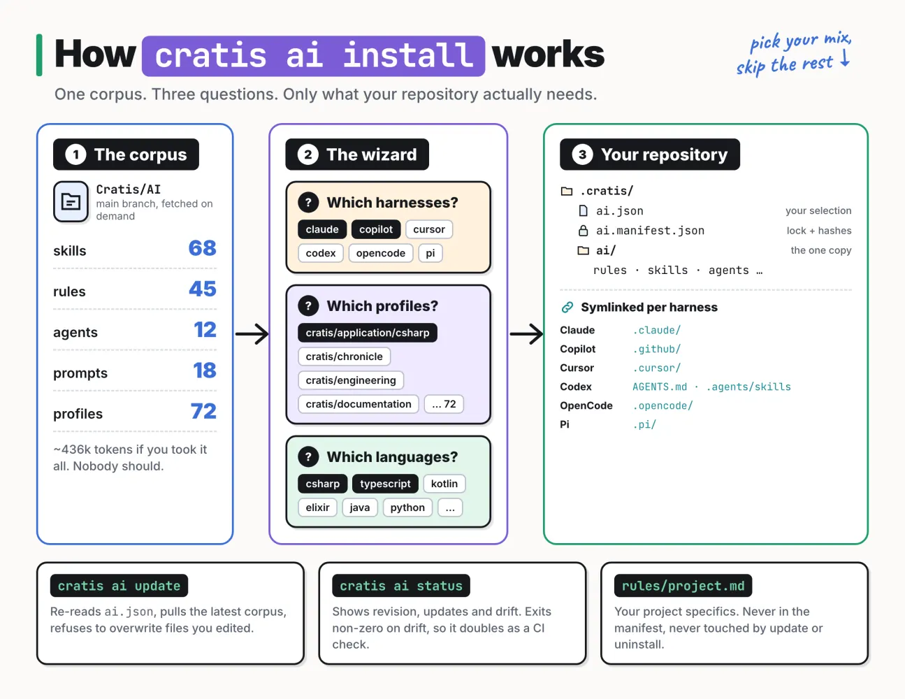

👋 Guest post: This edition is written by [Einar Ingebrigtsen](https://no.linkedin.com/in/einari), sharing his own perspective and experience. I’m also open to featuring more guest voices in future editions, so if you have something relevant to share with this community, feel free to reach out.

Your AI setup is code. It rots like code, it drifts like code, and at some point it needs a distribution story like code.

It took us eight months, 1,117 automated commits and one retired GitHub Actions system to fully accept that.

This is the story of how we at [Cratis](https://cratis.io/) went from copying instruction files between repositories by hand, to a single command that gives every repository exactly the AI guidance it needs. And nothing more.

### Some context

Cratis is an open source organization with a lot of repositories. Chronicle, our event sourcing database. Arc, our application model. Components, Fundamentals, Studio, the CLI and a long tail of smaller things. More than 30 active repositories, all expected to look and feel like they were built by the same people, because they were.

When we went agentic, consistency across all of those was the first thing we had to solve. An agent working in Chronicle should know the same conventions as an agent working in Arc. The way we write specifications, the way we name things, the way we model events. If the guidance differs between repositories, so does the output.

### It started with GitHub Copilot

Early on, GitHub Copilot was all we used. So we built what I've come to call our AI corpus, purpose built for Copilot. A copilot-instructions.md, a set of .instructions.md files scoped to file types, and as Copilot grew new features, we grew with it: skills, prompts, custom agents, hooks.

The way we worked with it was simple, and I'd argue it's still the most important habit we have. Whenever the agent did something wrong, we didn't just fix the code. We asked the LLM to understand why it went wrong and update the corpus so it wouldn't happen again. The corpus was constantly improving, from real friction, in real work.

Which meant it was constantly changing. And it lived in every repository. Copied by hand.

I know. Very silly. But that's how these things start, isn't it?

### Automating the pain away

The first real fix was a set of GitHub Actions workflows. It started in Chronicle back in January, and on March 1st we moved it into a shared [Cratis/Workflows](https://github.com/Cratis/Workflows) repository so every repository could use it.


*Automating the pain away*

The mechanics were quite neat, if I may say so:

1. Every repository got a thin wrapper workflow that triggered on a push to main touching any of the AI folders: .github/instructions, .github/skills, .github/agents, .github/prompts, .github/hooks and later .ai, .claude, .agents and .pi.
2. The wrapper called a reusable workflow in Cratis/Workflows. It listed every non-archived repository in the organization, dropped the source and an ignore list, and ended up with around 34 targets.
3. It packaged the corpus once as a workflow artifact, respecting a .copilot-sync-ignore file.
4. A matrix job fanned out, one job per target repository, writing blobs, a tree and a commit through the Git Data API. No checkout needed.

Initially the sync opened pull requests. That's what I wrote about [back in April](https://ingebrigtsen.blog/2026/04/12/Synchronizing-Copilot-Setup-Across-Repositories-and-Devices/). Turns out, 30+ PRs for a one-line tweak to a skill gets old very quickly. By mid-March we'd switched to committing directly to main, with the bot as a bypass actor on the branch protection rules.

The important design decision, and in hindsight the dangerous one: any repository could be the source. Find a problem while working in Chronicle? Fix it there. It would broadcast to everything else, including our central AI repository. There was no "go to the right repo first".

This obviously begs the question: what stops a sync commit from triggering another sync? A loop guard. If the head commit message started with Sync Copilot instructions from, the workflow did nothing. Simple, and it worked.

For a while this felt great. I could be on my Mac, my iPad or my phone, in any repository, and the setup was identical. Improvements just flowed.

### More harnesses, more shapes

Then we started experimenting with other agent harnesses. Claude Code first, then Codex, Cursor, OpenCode and Pi.

The good news: they all want roughly the same things. Rules, skills, agents, prompts. The bad news: they all want them in different places and in slightly different shapes.

So in April we moved the canonical content into a single .ai/ folder and made each harness folder point into it with symlinks. .claude/skills pointing to .ai/skills, .github/instructions pointing to .ai/rules, AGENTS.md pointing to .ai/rules/general.md, and so on. At the peak we had 104 symlink adapters in the AI repository alone. The sync workflows learned to preserve symlinks, and later to normalize them.

It worked. Mostly.

### Where it hurt

Looking back, there were six distinct pains, and they compounded.


*Looking back, there were six distinct pains, and they compounded.*

Context bloat. This was the big one. The corpus grew from roughly 50k tokens in February to roughly 290k by August. Every repository got all of it. When we started supporting more programming languages, it became painfully obvious: C# instructions don't apply to Elixir or Kotlin, but an agent working in an Elixir repository was still carrying them around. We were burning tokens on guidance that was irrelevant to the task, and IMO it made the agents worse, not just more expensive.

Same rule, many shapes. Yes, you can scope instructions to file types. Copilot has applyTo, Claude has paths, Cursor has its own .mdc format. Some harnesses have no globs at all and just read AGENTS.md. So the one mechanism that could have saved us from bloat wasn't reliably there.

Commit storms. 1,117 sync commits from March to August. 381 of them in August alone, 139 of them across two days. Every little improvement multiplied by 34.

Project specifics leaked. Shared guidance is great, but every repository also has its own quirks. We added support for a PROJECT.md file with project-specific instructions that "wins on conflict". It was supposed to stay local. Then Chronicle added one, and it happily got broadcast along with everything else. The fix commit put it best: Studio's PROJECT.md "had been reduced to Chronicle's several times over". Funny now. Not so much at the time.

Symlink versus folder. The symlinks that made multi-harness support possible also bit us. When .github/agents was a symlink in one repository and a real folder in another, the Git Data API didn't appreciate our tree writes. And a single run was doing over seven thousand blob writes.

Marketplaces. Midway through, the harnesses started supporting plugins and marketplaces. We jumped on it, because that's where our users are, and published marketplace manifests for Claude, Cursor, Copilot and Codex. That was great for reach. But every harness has its own format and feature set, and a plugin only gives you skills, all or nothing. No filtering by what you're actually building.

Everything had become convoluted. Constrained, hard to maintain and, to be honest, not user friendly at all. Not for us, and definitely not for the people using our open source products.

### Stepping back

Here's the thing. We had been trying to solve a distribution problem with a synchronization tool.

Syncing assumes everyone needs the same thing. We don't. Someone building an application on top of Chronicle and Arc needs very different guidance from someone working on Chronicle itself. Someone writing C# needs different rules than someone writing TypeScript or Elixir. And someone using Cursor needs a different folder layout than someone using Claude Code.

That's three independent dimensions: what you're doing, which languages you use, and which harnesses you run. No sync workflow and no marketplace was ever going to express that.

So in August we froze the sync. On September 10th we retired it, deleting 3,938 lines of workflows and scripts. The next day we shipped its replacement.

### cratis ai install

We already had a CLI, cratis, that people use to work with Chronicle and to create new projects. It was the obvious home.


*cratis ai install*

Run cratis ai install and you get a small wizard with three questions:

1. Which harnesses? Claude, Copilot, Cursor, Codex, OpenCode, Pi. Pick as many as your team uses.
2. Which profiles? This is where you say what you're doing. cratis/application for building an application on Cratis. cratis/chronicle if you're doing pure event sourcing. cratis/engineering if you're working on Cratis itself. cratis/documentation for docs repositories. And much finer grained profiles if you want them.
3. Which languages? C#, TypeScript, Kotlin, Java, Elixir, Python and a few more.

Or skip the wizard entirely:

```
cratis ai install \
  --profiles cratis/application/csharp \
  --harnesses claude,copilot \
  --languages csharp,typescript
```

Under the hood, profiles are composable. cratis/application/csharp composes Arc, Chronicle, Components, Fundamentals and the specification profiles, and each of those brings in its own skills. Language filtering then prunes anything that isn't relevant to what you picked. The corpus behind it all currently holds 68 skills, 45 rules, 12 agents, 18 prompts and 72 profiles. You get a slice of it.

What ends up in your repository is deliberately boring:

- .cratis/ai.json: your selection. Commit it, and the whole team gets the same setup.
- .cratis/ai.manifest.json: a lock file with the corpus revision and a SHA-256 hash for every managed file.
- .cratis/ai/: one copy of the selected corpus.
- Symlinks for each harness you picked, pointing into that one copy. .claude/, .github/, .cursor/, AGENTS.md and friends.

Yes, the symlinks survived. They were never the problem. Having them synced between 34 repositories was.

Then there's the lifecycle:

- cratis ai update re-reads your selection and pulls the latest corpus. If you've edited a managed file, it refuses to overwrite it unless you tell it to.
- cratis ai status tells you what's installed, whether there's an update and whether anything drifted. It exits non-zero on drift, so you can put it in your CI pipeline.
- cratis ai uninstall removes what it installed, and only that.

And project specifics? They live in .cratis/ai/rules/project.md. It's never recorded in the manifest, which means update and uninstall never touch it, and it can never be broadcast anywhere. An old PROJECT.md gets migrated automatically.

### Did it pay off?

Measured on the actual corpus, a typical C# application repository (cratis/application/csharp with C#) gets about 87k tokens of skill content instead of 239k. That's 64% less. The skill descriptions an agent loads up front at the start of every session go from roughly 8k tokens to 2.8k.

A TypeScript application talking to Chronicle gets about 11k tokens of skills. That's 95% less than the full corpus.

But honestly, the number I care most about is the one that went to zero: the number of sync commits landing in our repositories.

### What I'd tell you if you're on the same path

- Treat your AI corpus as a product. Improving it continuously from real friction is the single best habit we have. Keep that loop tight.
- Don't sync, distribute. Syncing assumes everyone needs everything. Nobody does. Context is a budget, not a dumping ground.
- Model the dimensions explicitly. For us it was what you're doing, which languages and which harnesses. Yours might differ, but name them.
- Keep one real copy and adapt the shape. Harnesses will keep diverging. Adapters are cheap. Duplicated content isn't.
- Keep local things local, by design. Not by convention and not by an ignore list you'll forget to update.
- Be where your users are. We didn't want to pick a harness for anyone. The same corpus now works for Claude, Copilot, Cursor, Codex, OpenCode and Pi.

None of this is finished. The harnesses keep moving, and we'll keep moving with them. The difference is that the next change is a new version of the corpus and a cratis ai update, not another 34 commits.

If you want to dig in, the corpus is open source at [github.com/Cratis/AI](https://github.com/Cratis/AI) and the CLI documentation is at [cratis.io/cli/ai](https://cratis.io/cli/ai/).

I'm curious how others are dealing with this. Are you keeping your AI setup in sync across repositories, or have you found a better way to distribute it?

#AgenticEngineering #AI #DeveloperExperience #OpenSource #GitHubActions #Cratis
