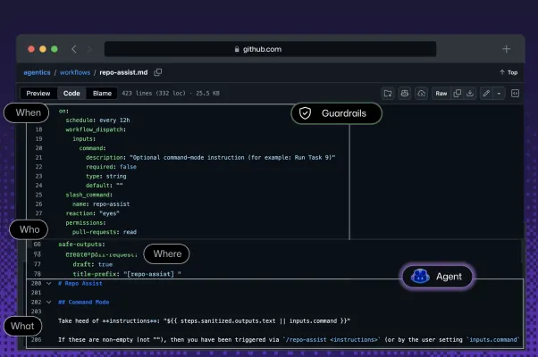
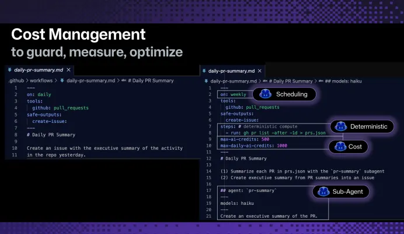

Welcome to the very first issue of Agentic Engineering in Action! Subscribe to get every new issue straight to your inbox — and share it with your team.

There's a seductive idea floating around every engineering org that has discovered GitHub Actions and GitHub Copilot in the same quarter: what if I just run the Copilot CLI inside an Action and let it triage my backlog? It feels like free leverage. You already automate builds, releases, and labels in Actions; bolting an agent onto that machinery looks like a weekend project.

It's also one of the fastest ways to get a public repository compromised.

### The problem and the solution

The problem isn't the agent's intelligence — it's the agent's inputs. The instant an LLM runs inside your CI environment, everything it reads becomes part of its context: the issue someone just filed, the body of an external pull request, a web page it fetched while "researching." On a public open-source repo, that means anyone on the internet can write text that your agent will faithfully treat as instructions. Prompt injection stops being a research curiosity and becomes a supply-chain attack. Hand that agent a token with write access and the GitHub CLI, and a cleverly worded issue can become an exfiltration or a malicious commit.

[GitHub Agentic Workflows](https://github.github.com/gh-aw/) are the answer to that specific failure mode — not by making the model "smarter about security," but by refusing to trust it with raw power in the first place. The design is worth understanding because it generalizes well beyond GitHub.

Start with how a workflow is written: a Markdown file. The front matter declares when it runs (a manual dispatch, a schedule, or a slash command like [/repo-assist](https://github.com/githubnext/agentics/blob/main/workflows/repo-assist.md)) and what it's allowed to touch (for example, pull-requests: read). The body of the file is simply the prompt — the same instructions you'd hand to the Copilot CLI, with a few variables substituted from the repository and the run. That file compiles down to an ordinary GitHub Actions workflow. Nothing exotic; the magic is in the constraints, not the syntax.


*Start with how a workflow is written: a Markdown file.*

Those constraints form a three-part pipeline. Inputs are treated as untrusted: triggers from issues and PRs, and any web content the agent loads, are the prompt-injection surface, full stop. Permissions are least-privilege: the workflow gets exactly the read/write/access scopes you declare, enforced by GitHub's own token model. And then the part that makes the whole thing defensible — safe outputs. Even when you grant the agent permission to comment, it cannot reach for the gh CLI or git directly; those binaries aren't in its sandbox. Instead it emits a structured description of the action it wants to take, and separate tooling — outside the model's execution scope — carries that action out, bounded by the permissions you set. A workflow that's allowed to "comment on an issue" can do that and nothing else. The blast radius is defined by configuration, not by the model's good behavior.

That architecture is what turns agents from a liability into something you'd actually schedule. Teams pointing a "repo assist" workflow at neglected repositories watched open-issue counts fall as the agent labeled, investigated, and closed issues that were duplicates, stale, or filed against the wrong project — each step gated by a human maintainer. The same primitive scales outward: a single "central ops" repo can read across roughly twenty others and assemble one status dashboard, instead of a human opening twenty tabs every morning.

### What about cost?

Two practical notes for anyone budgeting this. First, determinism is a cost strategy, not just a correctness one. If a step is deterministic — "list last week's PRs" — run gh pr list with a date range, don't pay an LLM to reason its way to a shell command. The platform now ships token auditors and optimizer workflows precisely so you can see which models burned tokens on which steps and trim the waste.


*Determinism is a cost strategy, not just a correctness one.*

Second, the friction is dropping: a newly shipped permission lets a workflow use the GitHub Actions token itself for inference, so teams — especially those on managed enterprise identities — [no longer have to babysit short-lived personal access tokens](https://github.blog/changelog/2026-06-11-agentic-workflows-no-longer-need-a-personal-access-token/). And if you've already built a custom harness on the Copilot SDK, it loads into the same sandbox and inherits the same guardrails.

The takeaway is simple. Agentic automation in your repos is ready for real work — but the unit of safety is the sandbox, not the prompt. Reach for GitHub Agentic Workflows, declare the narrowest permissions that get the job done, lean on safe outputs, and invest in tests before you invest in autonomy. The shortcut of a bare LLM in your pipeline isn't a shortcut; it's an incident waiting for a pull request.

### One more thing — a skill to make this easier

If you're going to live in GitHub Agentic Workflows, the authoring experience matters. I maintain a GitHub Agentic Workflows agent skill that gives your coding agent first-class help writing, configuring, and reasoning about these workflows — so scaffolding a safe, least-privilege workflow (with the right triggers, scopes, and safe outputs) becomes a conversation instead of a copy-paste hunt through the docs.

It's open source and ships as part of my [AI-Native Development skills marketplace](https://github.com/webmaxru/ai-native-dev).

Add the marketplace, then the plugin:

```
/plugin marketplace add webmaxru/ai-native-dev
/plugin add ai-native-dev-skills@webmaxru-ai-native-dev
```

Just want this one skill? Install it directly with APM:

```
apm install webmaxru/ai-native-dev/skills/github-agentic-workflows
```

…or with npm:

```
npx skills add webmaxru/ai-native-dev --skill github-agentic-workflows
```

VS Code (GitHub Copilot): Command Palette → Chat: Install Plugin From Source →  [https://github.com/webmaxru/ai-native-dev](https://github.com/webmaxru/ai-native-dev)

Repo, docs, and the full skills catalog: [https://github.com/webmaxru/ai-native-dev](https://github.com/webmaxru/ai-native-dev)

I build and maintain this in the open — feedback and PRs welcome!
