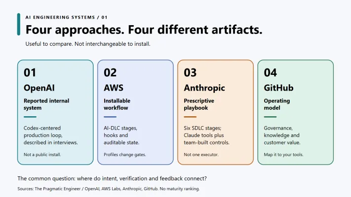
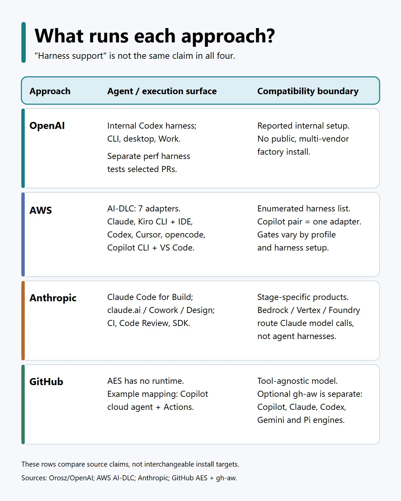
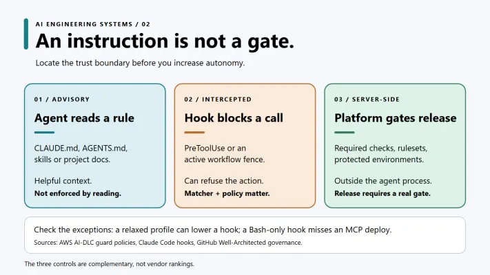
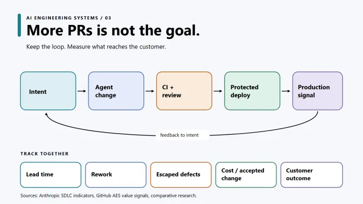

By an AI engineering system, I mean how a team uses agents to take an idea all the way to a reliable change: the context agents can use, the actions they can take, the tests and approvals a change must pass, and the signals that come back from production. A coding agent is part of that system, not the whole thing.

You will hear related ideas called a software factory, an AI-native or agentic SDLC, AI-DLC, or an agentic engineering system. Some people talk about the outer loop around the agent's coding loop - what we might call an outer agent loop. The names overlap, but they are not identical blueprints.

While I work hard on building a reference implementation of an AI Engineering System powered by GitHub Enterprise and GitHub Copilot (stay tuned), I compare four recently released public descriptions of alternative approaches side by side in this article: [OpenAI's software factory, as reported by The Pragmatic Engineer](https://newsletter.pragmaticengineer.com/p/openai-software-factory), [AWS AI-DLC Workflows](https://github.com/awslabs/aidlc-workflows), [Anthropic's AI-native SDLC playbook](https://claude.com/blog/the-ai-native-sdlc-playbook), and [GitHub's Agentic Engineering System](https://github.com/resources/insights/agentic-engineering-system).

My first observation: these are not four versions of the same product.

OpenAI's example is a report about an internal, running engineering setup. AWS publishes an installable workflow framework, with stages, agents, hooks, and audit records. Anthropic gives us a playbook for connecting Claude tools with a team's own processes. GitHub offers an operating model - governance, shared knowledge, and customer value - and then shows how GitHub features can support it.

That is a useful distinction. You can learn from all four, but you cannot "install" all four in the same sense.

*Four sources, four different kinds of artifact. This is not a maturity ranking.*

### The part they have in common

Strip away the product names and a familiar loop appears: a person defines an outcome; the agent gets enough context to work; it plans or changes code; tests and CI check the result; someone or something assesses the risk; the change reaches production; production tells us what to do next.

The interesting work is in the connections. Where does the context come from? Who can approve a risky change? Does an incident become a new piece of work, or just another dashboard notification?

OpenAI's reported pipeline goes particularly far into deployment and operations: Codex helps with code and CI; specialist agents review changes; a human approves production rollout; other agents watch performance or assist with incidents. The important limit is easy to miss: its incident bot proposes mitigations but does not execute them without an engineer. This is an account of OpenAI's private infrastructure, not a public recipe for reproducing it.

AWS takes a different route. AI-DLC defines 33 selectable stages across five phases, from initialization to operation, and records workflow state and decisions in the project. That gives a team something concrete to inspect and adapt. It also means choosing a profile is a design decision, not a cosmetic preference.

### What actually runs each approach?

"Supported harnesses" sounds like a single comparison axis, but the four sources use different kinds of systems. Only AWS publishes a compatibility list. Here is the honest four-way view:

*What actually runs each approach?*

That difference matters more than a compatibility count. The OpenAI article's perf harness evaluates PR performance; it is not another coding-agent host. Anthropic's cloud-provider options change where Claude model calls run, not which company's agents execute its playbook. And GitHub's model can guide a team without installing an agent at all.

The common thread is the handoff, not a common runtime. Anthropic's six-stage playbook makes handoffs visible with artifacts such as intent.md, spec.md, and plan.md. GitHub's model asks a complementary question: are governance and shared knowledge growing along with agent usage, and is the extra delivery actually creating customer value? Neither document magically supplies every integration or control it describes. The team still has work to do.

### Where a suggestion becomes a gate

Here is the distinction I would check first in any AI engineering proposal:

An instruction in a file is not the same as a blocked action. And a blocked agent action is not the same as a protected merge or deployment.

For example, [Claude's documentation](https://code.claude.com/docs/en/memory) says CLAUDE.md is context, not enforced configuration. A PreToolUse hook can block a matching tool call; a repository ruleset or protected environment moves the decision outside the agent's process.

Even a real hook needs the right policy. In [AWS AI-DLC's source](https://github.com/awslabs/aidlc-workflows), the poc and mvp profiles default to a relaxed guard policy, while express defaults to off. In those settings the plan-approval fence stands aside; if you need it as a gate, select and verify a strict policy. Conversely, Anthropic's illustrated production hook checks a local approval variable and matches Bash commands. It is a starting example, not proof that every deployment path has a release-manager approval.

GitHub's [Well-Architected guidance](https://github.com/github/github-well-architected) maps the model onto rulesets, CODEOWNERS, required checks, and environment protection. When configured properly, these controls cannot be passed merely because an agent writes a more convincing paragraph.

*Ask where the rule is enforced, who can change it, and which tool paths it covers.*

### What should a team try first?

I would not start by attempting to copy OpenAI's entire factory. Its internal review routing, per-change monitoring, and incident tooling are not a public package. Nor would I treat a diagram of six stages or three stocks as an installation guide.

Start with one low-risk, well-defined change type in a repository that already has tests and a real merge gate. Make the relevant decisions and documentation easy for an agent to find. Keep a named human accountable for the PR and production decision. Then run enough comparable changes to see where the work actually moves: less waiting, or simply more review and more rework?

And let's be careful with the numbers. The often-repeated "~90% usage" in the [OpenAI chart](https://openai.com/index/how-agents-are-transforming-work/) refers to the average person's share of monthly output tokens generated on Codex in the departments shown. It does not mean 90% of staff adopted the tool, and it certainly does not prove a 90% productivity gain. More PRs have the same problem: volume alone cannot tell us whether the result was useful.

I would track lead time alongside first-pass CI success, review effort, rework, escaped defects, and cost per accepted change. If delivery gets faster while defects or reviewer load grow, we have moved the bottleneck, not improved the system.

*More PRs is not the goal*

That is the part of "AI-native engineering" I find most useful. The difference between a fast coding demo and an engineering system is not how much code the agent writes. It is whether the team can explain why a change was made, who could approve it, how it was verified, and what happened after release. Make context, authority, verification, and feedback real in one small loop before asking agents to do more. If those answers exist only in a prompt, there is still a system to build.

Where are you on your journey? Experimenting with coding agents, putting enforceable gates around them, or already feeding production signals back into the work?

#AISystem #AgenticSDLC #SoftwareFactory
