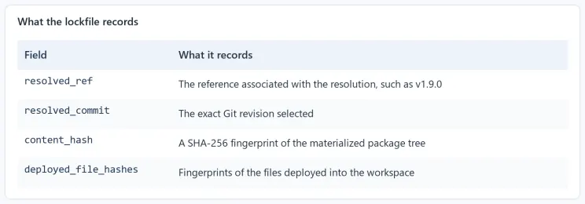

Building a supply chain for agent context with Microsoft Agent Package Manager

An AI coding agent’s working environment starts taking shape before we send the first prompt. We equip it with project conventions, reusable skills, specialized agent definitions, workflow automation, and connections to external tools and information. Together, these customizations influence what the agent knows how to do and which capabilities are available to it.

Keeping track of that environment is harder than assembling it. A skill arrived with an extension. A custom agent lives in your user profile. A colleague shared a release prompt, while another project introduced an MCP server connection. You switch machines or coding tools, and suddenly the collection is different. Even on a familiar machine, opening your agent can reveal a customization you do not remember installing.

The convenience is real. So is the growing gap between the setup your team thinks it shares and the one available to each developer. Where did these customizations come from? Which versions did we approve? Can a teammate reproduce the managed setup? What catches an unexpected change?

I use customizations as the umbrella term for the reusable assets and configurations we provide to our agents. Their individual building blocks are AI-native development primitives: skills, instructions, prompts, custom agents, hooks, and tool integrations. “Agent context” describes the broader setting these help establish. This article focuses on the part we can declare, distribute, and review as project dependencies; conversation history, retrieved results, and other changing inputs also contribute to an agent’s context.

These building blocks serve different purposes:

- Instructions and rules capture conventions and constraints for a project or scope.
- Skills package reusable procedures, often with supporting references, assets, or scripts.
- Prompts and commands provide reusable entry points for tasks such as review or release preparation.
- Custom agent definitions describe specialized roles and their configuration.
- Hooks connect automation to events in the agent tool’s workflow.
- MCP server configurations connect agents to servers that expose tools and information.

Packages and plugins can distribute several of these together. Their formats and support vary across agent tools, so the package layout and selected targets matter.

We already have a discipline for dependencies that influence our software: declare them, resolve versions, review updates, and check them in CI. The same discipline belongs here. A review skill can shape a finding, a custom agent can specialize a task, and a hook or tool connection can introduce an operational capability. Each deserves an identifiable source and a deliberate change process.

This is the problem [Agent Package Manager, or APM](https://microsoft.github.io/apm/) addresses. Microsoft’s open-source dependency manager lets a project declare its customizations in apm.yml, deploy supported primitives to selected agent tools, and record dependency resolution in a lockfile. The examples below come from the [Meridian example repository](https://github.com/webmaxru/meridian-agent-context-demo) (Meridian is a fictional company name).

## Quickstart

Consider a checkout service whose developers use multiple AI agent harnesses. They need a shared set of customizations, with a clear way to review and reproduce the supported parts across their tools.

Start with a skill to make the dependency workflow tangible. The example is pleasantly recursive: it helps an agent work with APM itself. We will then add a prompt and follow the resulting dependencies through deployment, verification, and policy. These are concrete examples of the broader customization supply chain.

With APM installed using the [official installation instructions](https://microsoft.github.io/apm/quickstart/), run the following from a disposable project directory. Shell examples use PowerShell.

```
apm init --yes --target copilot
apm install 'webmaxru/ai-native-dev/skills/agent-package-manager#v1.9.0'
```

The coordinate identifies the repository owner, repository, path to the skill, and selected release. Quoting the complete coordinate keeps its # reference together as a shell argument.

The change worth noticing is in apm.yml: the skill now has a dependency declaration. The installed folder has an explanation that another developer can inspect and reproduce.

For the team, that single declaration grows into a shared inventory of project customizations. Here is the example’s five-asset manifest, with descriptive metadata omitted for brevity:

```
name: meridian-checkout-public-context
version: 1.0.0

targets:
  - claude
  - copilot
  - cursor

dependencies:
  apm:
    - webmaxru/ai-native-dev/skills/agent-package-manager#v1.9.0
    - webmaxru/ai-native-dev/skills/ard-registry-builder#v1.9.0
    - webmaxru/ai-native-dev/prompts/version-bump-and-deploy.prompt.md#v1.9.0
    - webmaxru/ai-native-dev/skills/github-agentic-workflows#d04f0b01d6d4f08230f297d4a0e636fd482b3a90
    - webmaxru/ai-native-dev/skills/agent-skill-deploy#d04f0b01d6d4f08230f297d4a0e636fd482b3a90
  mcp: []

includes: auto
scripts: {}
```

Save it as apm.yml, then run "apm install". The [complete manifest](https://github.com/webmaxru/meridian-agent-context-demo/blob/main/demo/snippets/apm-consume.yml) declares four skills and one prompt. Three dependencies use a readable release tag; two use a full commit SHA. The prompt is a separate primitive with its own deployment behavior, even though it shares a dependency source with the skills.

The empty mcp: [] is intentional: this example does not configure tool servers. APM also supports MCP declarations, but they introduce a different verification surface: server configuration and sourcing rules. Pinning a customization package does not freeze the responses of an external service. See the [MCP installation guide](https://microsoft.github.io/apm/consumer/install-mcp-servers/) when extending the manifest with tool connections.

For these targets, skills go into .agents/skills/ for Copilot and Cursor, and .claude/skills/ for Claude Code. The prompt is placed in .github/prompts/ and adapted into command files under .claude/commands/ and .cursor/commands/. APM’s [targets matrix](https://microsoft.github.io/apm/reference/targets-matrix/) documents the supported primitives and paths.

That adaptation matters across primitive types. In this example, APM can report that unsupported agent and name frontmatter fields were dropped from the command variants. Read those diagnostics: successful deployment does not imply that every source feature survives on every target. Portability means maintaining a common declaration and understanding its supported outputs; the agent tools still determine how they use those outputs.

You can inspect the result directly:

```
Get-ChildItem -File -Recurse .agents/skills,.claude/skills -Filter SKILL.md |
  Resolve-Path -Relative

Get-Item .github/prompts/*.prompt.md,.claude/commands/*.md,.cursor/commands/*.md |
  Resolve-Path -Relative
```

(or just check which resources were added in your IDE's file tree).

The next question arrives when a teammate clones the project next week: what exactly should they receive?

A release tag is convenient to read, but a Git tag can be moved. A full commit SHA identifies a specific revision. APM records the resolved commit in apm.lock.yaml, along with package and deployment information. Commit that file alongside the manifest.

Four fields make the record useful:


*What the lockfile records*

Package hashes and deployed-file hashes have different jobs. The latter cover the target-specific outputs, including adapted prompts. For UTF-8 text, APM normalizes CRLF to LF before computing deployed-file hashes, so ordinary Windows line endings do not create false tampering signals.

Use a frozen install when the requirement is to replay the committed resolution:

```
apm install --frozen
```

[Frozen](https://microsoft.github.io/apm/reference/cli/install/) refuses a new resolution and fails when the lockfile is missing or inconsistent with the manifest. The script also verifies that this particular replay left the lockfile byte-identical. That is a useful demonstration of recorded state; the separate audit checks consistency and drift.

```
apm audit --ci --no-policy
if ($LASTEXITCODE -ne 0) { throw 'Agent context audit failed.' }
```

Here, --no-policy deliberately isolates the baseline and drift checks from organizational sourcing rules. A clean result establishes agreement among the relevant manifest, lockfile, deployment, and replay evidence. It does not establish that every customization is appropriate, that its behavior is safe, or that different agents will produce identical results.

## Enforcing a specific skill registry

Meridian now has a repeatable set of managed customizations. Its payment team still needs to decide what belongs in that set. For a review skill, that means evaluating the review procedure. For a hook or tool integration, it also means assessing the actions it enables and the access it needs. Reproducibility preserves a selection; people still own the approval decision.

The example makes that decision concrete with a deliberately flawed refund function:

```
type RefundRequest = {
  paymentAttemptId: string;
  amount: number;
  cardNumber: string;
};

export async function retryRefund(request: RefundRequest): Promise<void> {
  console.log("retrying refund", request.cardNumber, request.amount);

  await fetch("https://payments.meridian.example/refunds", {
    method: "POST",
    body: JSON.stringify({ amount: request.amount }),
  });
}
```

This is [example code to review](https://github.com/webmaxru/meridian-agent-context-demo/blob/main/reference/governed-checkout/src/refund.ts), not a production implementation. It logs card data, leaves paymentAttemptId unused, and gives no explicit treatment to uncertain provider outcomes. A generic style guide would miss the point of this example.

Meridian’s secure-payment-review skill captures the team’s specific review requirements: use its Money value object, make retries idempotent by paymentAttemptId, exclude sensitive information from logs, validate payment-state transitions, and treat timeouts as an unknown outcome until confirmed. Its metadata names Meridian Platform Engineering as author and platform-security as owner. You can inspect the [deployed skill in the public reference workspace](https://github.com/webmaxru/meridian-agent-context-demo/blob/main/reference/governed-checkout/.agents/skills/secure-payment-review/SKILL.md).

The source catalog lives in a separate private Git repository. “Registry” here means Meridian’s curated Git-based catalog; this example does not require a dedicated registry service. Its first dependency is a payment-review skill, but the catalog can grow to include other supported primitives or packages that bundle them.

In a separate governed project configured with the same three targets, installation looks familiar:

```
apm install 'webmaxru/meridian-agent-context-registry/skills/secure-payment-review#v1.0.0'
```

That private source intentionally requires authorized access. Readers can inspect the public reference files, but cannot replay the private dependency without permission; use an equivalent repository you control to reproduce this half of the walkthrough. APM supports GitHub authentication through gh auth login or GITHUB\_APM\_PAT. Credentials belong in the authentication environment, separate from dependency coordinates.

Privacy alone does not establish trust. Meridian’s review and release process makes the approval decision for each customization. The dependency declaration and lockfile make the selected result traceable, whether the package supplies one skill or a collection of primitives.

The next step is to express the sourcing rule. This is the [policy supplied with the example](https://github.com/webmaxru/meridian-agent-context-demo/blob/main/demo/snippets/apm-policy.yml):

```
name: Meridian approved agent context
version: "1.0.0"

enforcement: block
fetch_failure: block

dependencies:
  allow:
    - webmaxru/meridian-agent-context-registry
    - webmaxru/meridian-agent-context-registry/**
  require_pinned_constraint: true
```

The allowlist covers the repository and nested package paths. It governs dependency sources across package contents. With enforcement: block, policy violations fail. require\_pinned\_constraint rejects unbounded declarations such as bare branches and wildcards; the current documentation also permits bounded semver ranges, so this setting is not a full-SHA-only rule. This small policy addresses package sourcing; MCP connections have their own policy controls.

There is a subtle failure case worth getting right. fetch\_failure: block governs failed refreshes when a cached policy is available. For remote discovery with no usable policy, the consumer-side setting is policy.fetch\_failure\_default: block in apm.yml. The example instead supplies a local policy explicitly and makes its presence a separate required check.

From the governed project directory:

```
apm policy status --policy-source ./apm-policy.yml --check
if ($LASTEXITCODE -ne 0) { throw 'Required policy is unavailable.' }

apm audit --ci --policy ./apm-policy.yml --no-fail-fast
if ($LASTEXITCODE -ne 0) { throw 'Governed context audit failed.' }
```

The first command verifies policy discovery; the second evaluates the workspace against the explicit policy and runs all checks for a complete diagnostic report. The example’s captured APM 0.28.0 output reports 31 passing checks. Treat that count as a recorded result for this setup, rather than a permanent CLI contract. APM’s built-in security scanning also checks for hidden Unicode, but that is not a semantic review of a prompt or a guarantee against prompt injection.

APM also enforces applicable policy during installation when it is discovered or supplied. The explicit audit gives us a separate verification point after installation or subsequent edits. Developers retain local bypass mechanisms, described in the [official governance guide](https://microsoft.github.io/apm/enterprise/governance-guide/), so a passing check on one machine cannot establish the repository’s merge boundary.

## That local freedom is why the final control belongs in CI.

Consider a pull request that changes the shared agent setup while leaving application code untouched. It might alter a review skill, replace a release prompt, or change a managed tool configuration. The checkout application may still compile, and its tests may remain green. The consequences emerge when an agent next uses that customization. A context audit gives reviewers a separate check on the managed inputs to future development.

The repository’s [supply-chain workflow](https://github.com/webmaxru/meridian-agent-context-demo/blob/main/.github/workflows/apm-supply-chain.yml) audits the committed governed reference workspace:

```
name: APM supply-chain gate

on:
  pull_request:
  push:
    branches: [main]
  workflow_dispatch:

permissions:
  contents: read

jobs:
  audit:
    name: audit
    runs-on: ubuntu-latest
    timeout-minutes: 10
    environment: meridian-registry
    defaults:
      run:
        working-directory: reference/governed-checkout

    steps:
      - name: Check out the declared context
        uses: actions/checkout@11d5960a326750d5838078e36cf38b85af677262

      - name: Install the pinned APM CLI
        uses: microsoft/apm-action@d723bb64ed70c135bbaf87d126b721dd2dae0439
        with:
          apm-version: "0.28.0"
          setup-only: true

      - name: Require the policy
        run: apm policy status --policy-source ./apm-policy.yml --check --no-cache

      - name: Audit source, lockfile, hashes, drift, and policy
        env:
          GITHUB_APM_PAT: ${{ secrets.MERIDIAN_REGISTRY_PAT }}
        run: apm audit --ci --policy ./apm-policy.yml --no-cache --no-fail-fast
```

The line to study is setup-only: true.

This repository commits its deployed context files. CI needs to inspect those submitted files before anything restores them. An installation step could replace an edited skill with a clean copy, removing the mismatch the audit should detect. Setup-only installs the CLI; the audit can use a separate, lock-pinned scratch installation for replay checks without repairing the checkout. Repositories that ignore deployed outputs need a different restore strategy.

To adapt the workflow, point working-directory at your actual APM project and configure your own protected environment and source credential. The pinned action revisions and CLI version above are the example baseline; review updates to the auditing tools as deliberately as updates to the customizations they verify.

A workflow becomes a merge gate through repository settings. The example’s documented setup requires the audit check and an owning review, protects changes through [CODEOWNERS](https://github.com/webmaxru/meridian-agent-context-demo/blob/main/.github/CODEOWNERS), and requires approval for access to the private-registry environment. Its contribution model uses branches in the same repository because fork workflows do not receive that private-source secret. The repository’s [setup notes](https://github.com/webmaxru/meridian-agent-context-demo/blob/main/README.md) describe this contribution model.

With those protections maintained, an ordinary contributor cannot merge without satisfying the required check and review. Administrators who can change the protections remain a trust boundary. APM also does not sandbox a running agent or govern every customization installed in a developer’s user profile. Its guarantees must stay attached to the dependencies, files, policy, and repository controls being checked. [Governance boundaries](https://microsoft.github.io/apm/enterprise/governance-guide/)

The practical outcome is a reviewable update process for the project’s managed agent environment. When a customization changes, its owner reviews and releases the source. A consuming project updates its dependency, regenerates the relevant lock and deployment state, and submits the change through the same audit and review path. Several projects can consume one maintained source while adopting its revisions at their own pace. The review criteria depend on the primitive; ownership and change control apply across the collection.

Begin by identifying the customizations your team already relies on and where they come from. Bring one shared dependency into the manifest, pin its revision, and commit the lockfile. Then extend that inventory across the primitive types your tools support. Use the [public consumption reference](https://github.com/webmaxru/meridian-agent-context-demo/tree/main/reference/consume-checkout) to see the resulting files, and the [governed reference](https://github.com/webmaxru/meridian-agent-context-demo/tree/main/reference/governed-checkout) to inspect the policy and CI inputs.

Before the next agent writes a line of code, your repository can already explain which customizations the project declares, where they came from, how they are deployed, and which changes passed review. That gives the team a controlled foundation for the context and capabilities it provides to its agents.

## Turn agent context into managed dependencies

APM helps teams replace scattered, manually installed agent customizations with a workflow they already understand from software dependencies. It provides one manifest for declaring context, a lockfile for reproducible resolution, multi-tool deployment, integrity and drift checks, source policies, and CI-ready audits. The result is agent context that can be discovered, pinned, reviewed, shared, updated, and governed instead of merely copied between machines.

Continue with these resources:

- [APM documentation](https://microsoft.github.io/apm/) for installation, commands, package types, and governance guidance.
- [The Missing Package Manager](https://apm.isainative.dev/) for my free, full-length guide to managing AI agent context with APM.
- [My maintained APM agent skill](https://github.com/webmaxru/ai-native-dev#agent-package-manager) to give your coding agent practical guidance for installing, configuring, auditing, and operating APM.

Start with one dependency. Pin it, inspect it, audit it, and make the result reviewable. Then grow from a working example into a dependable supply chain for every customization that shapes your agents.
